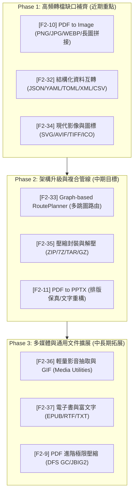

# Clickra 發展規劃 (Roadmap)

**規劃週期**：2026年10月 — 2026年12月

本文件定義了 Clickra 後續的功能擴張與視覺體驗優化標準，目標是從一個實用的腳本套件進化為精緻的 Windows 應用程式。

> **文件角色**：ROADMAP 是里程碑／產品方向追蹤，不是 live Git/PR/release/Store state 的權威來源。文中的版本、PR、日期、「目前」「最高優先級」等敘述若帶有時間背景，均視為該時間點的 planning snapshot；執行 branch、release 或 Store 操作前必須重新查目前 repository / GitHub / Store evidence 與當次 rollout governance。

> **里程碑對應**：各子項標題前的編號（如 `[F2-1] Word to PDF`）即 GitHub 里程碑，命名與 GitHub 一致。

## 1. 視覺體驗與使用者介面 (Visuals & GUI)

為了提升 Clickra 的產品質感，已導入符合 Windows 11 Fluent Design 的視覺元素：

- [x] **[F1-1] Menu Visibility Optimization**：選單動態過濾（v3.0.6）。

    - **精確顯示**：已實作 `GetState` 邏輯，確保在不支援的檔案上完全隱藏選單。

- [x] **[F1-2] Native Dashboard Implementation**：Native 儀表板實作（v3.0.6）。

    - 基於 Native Win32 與 AOT 實作，整合 Office 狀態偵測。

- [x] **[F1-3] GUI with Options**：具備設定選項的 GUI（v3.0.8）。

    - **轉換設定與歷史**：提供 Dashboard 設定介面，顯示轉換歷史紀錄。

    - [x] **進度可視化**（v3.0.7）：處理過程中顯示動態進度條與完成通知。

- [x] **[F1-4] Startup Experience**：Windows 啟動體驗（v3.0.6）。

    - 已實作基本啟動顯示（暫不開發額外的現代化介面）。

- [x] **[F1-5] GUI & Layout Fixes**：Dashboard 視窗與佈局修復（v3.0.9）。

    - **最大化佈局修復**：修正視窗最大化後佈局未自適應縮放、背景出現大片黑色空區塊與元件重複重疊繪製的問題。

    - **最小化與系統匣整合**：實作最小化按鈕隱藏至 Windows 系統匣（System Tray / NotifyIcon）的功能，支援雙擊系統匣圖示恢復視窗。

    - **高 DPI 模糊修正 (High DPI Awareness)**：修正高解析度螢幕（2K/4K 等）下畫面模糊的問題，宣告 DPI 感知（DPI Aware）並在 Win32/GDI+ 繪製與佈局計算中動態套用 DPI 縮放因子。

- [x] **[F1-6] Dashboard Minor Enhancements**：Dashboard 細部功能優化（v3.0.9）。

    - **偏好設定自訂路徑**：於設定頁面新增可開啟 Windows 原生資料夾瀏覽器 (FolderBrowserDialog) 的按鈕，允許使用者設定任意自訂的預設輸出目錄。

    - **歷史紀錄卡片展開**：轉換歷史項目支援點擊展開顯示詳細資訊，包括輸入路徑、輸出路徑、原始檔名、轉換起訖時間與精確的轉換耗時。

    - **關於與說明頁面**：新增獨立的說明分頁，展示專案說明、一鍵診斷回報機制說明與協作開發指引。

    - **快速轉檔流程優化**：改為「檔案優先」互動流程，使用者先拖入/選取檔案，系統自動識別類型後，動態標註 (Highlight) 可用的轉檔動作，並停用 (Disable) 不支援的動作。

- [x] **[F1-7] Window Behavior & System Tray Optimization**：視窗行為與系統匣最佳化（v3.1.0）。

    - **系統匣支援調整**：新增進度視窗的最小化至系統匣支援（顯示轉換進度 % 與通知），並由進度視窗作為主要的系統匣承載介面。

    - **單一實例檢查**：主 Dashboard 啟動時強制進行單一實例（Single Instance）Mutex 檢查，重複啟動時直接還原並啟動已有視窗，避免累積多個失效圖示。

    - **進度視窗取消與關閉確認**：進度視窗支援關閉/取消防呆提示，關閉時主動寫入 Failed 歷史狀態（原因標註為 User Aborted）並清理進行中任務，解決歷史遺留 `Converting` 卡死的問題。

    - **歷史日誌拆分儲存**：批次轉換任務在歷史中全面拆分為個別獨立的檔案紀錄行（One Row Per File），在 UI 中移除「X files」欄位，改為直接清晰地顯示每個檔案的名稱與結果。

    - **右鍵選單優化**：當選取項目僅為「單個 PDF」時，在右鍵選單中隱藏 Clickra 主選單，避免出現空的子選單。

- [x] **[F1-8] Dashboard History Layout Optimization**：儀表板歷史排版優化（v3.2.0）。

    - **歷史紀錄與檔名寬度自適應**：實作歷史紀錄排版自適應與檔名寬度自適應，優化設定介面文字排版以消除重疊。

    - **「錯誤/取消」精準化判定**：歷史紀錄欄錯誤狀態「錯誤/取消」精準化判定，修復使用者中途取消卻被判定為成功的 bug。

    - **翻譯目標語言簡化**：移除多餘且暫不可用的 PDF 翻譯目標語言，僅保留下拉式選單與繁體中文選項。

- [x] **[F1-9] Progress Window Inline Input Optimization**：進度視窗內嵌輸入框優化（v3.3.0）。

    - **內嵌式密碼輸入**：實作於進度視窗內繪製與管理 Win32 Edit 控制項，實現無閃爍且支援 Enter 鍵送出、Esc 鍵取消的內嵌密碼輸入。

    - **加密狀態預檢**：自動判定 PDF 是否有加密，無加密檔案直接顯示提示不進行重複要求。

- [x] **[F1-10] Fluent Dashboard Migration (WinUI 3)**：Fluent 主介面與右鍵進度遷移。

    - Dashboard、Settings、History 與右鍵轉換進度已移至 `Clickra.Fluent`，直接重用 `Clickra.Core`、既有設定格式與歷史格式。

    - Explorer 透過 packaged activation 啟動 Fluent；NativeAOT Shell 維持輕量 COM 邊界，舊 Win32 UI 保留為 NativeAOT 軌道 fallback（見 F1-11）。

- [x] **[F1-11] Dual-Track Distribution (Fluent / NativeAOT)**：雙軌發行。

    - 2026/08 決定維持兩條軌道：本機有 .NET 8+ 與 Windows App Runtime → 安裝 Fluent；任一缺失 → 安裝 NativeAOT（零依賴）。

    - 新增 `ClickraLauncher.exe`（NativeAOT bootstrapper）自動偵測 runtime 並安裝對應軌道；新增 `Clickra.msix (Main)` 零依賴套件與 `scripts/build_msix.ps1`。

    - 舊 Win32 Dashboard/Progress 於 3.x 週期內作為 NativeAOT 零依賴軌道維持運作；在 4.0 跨平台 GUI 統一前持續維護。

    - 當時的詳細雙軌設計紀錄見 `docs/development/archive/dual_track_guide.md`；目前 release pipeline 另以實際 workflow/scripts 為準。

    - **4.0 架構收斂演進**：2026/11 核准之 [4.0 跨平台統一規格 (v4_cross_platform_unification.md)](specs/v4_cross_platform_unification.md) 將雙軌制定調為 3.x 歷史過渡期方案。在 4.0 階段三統一跨平台 GUI 通過 NativeAOT 零依賴驗收後，將正式除役 Win32 與 WinUI 3 雙軌介面。

- [x] **[F1-14] Shell Context Menu Icons**：右鍵選單圖示（v3.7.0）。

    - 為所有右鍵轉檔命令新增專屬圖示（PDF、Word、Excel、PPT、圖片操作），並提供 PowerShell 產生腳本。

- [ ] **[F1-15] v3.19.0 Core Decoupling & Module Standardization**：核心跨平台解耦與模組標準化。

    - [x] 實作用例自宣告協議（消除畫面端 10+ 處寫死的指令 ID 分支，根治 C4 債務；Phase 1 完成）。

    - [x] 統一單一執行管線 ConversionExecutionService（消除 CLI 與視窗平行排程，根治 D1 債務；Phase 2 完成）。

    - [x] 建立模組黃金標準目錄（Application/、Processing/、Domain/、Presentation/、Infrastructure/；全數消除歷史 Execution/；Phase 3 完成）。

    - [x] 導入模組目錄白名單、Options 歸位與分層防穿透自動化架構守衛測試（Guard 1~3；Phase 3 完成）。
    - [x] 導入畫面端硬編碼指令禁絕 Roslyn AST 守衛（Guard 4；Phase 4 完成）。
    - [ ] 兩層領域分類重構與對稱子模組標準化（Doc, File, Img, Pdf, Sys 二級領域與 Shared 封裝；最終收尾階段）。

    - 解耦 Windows 專屬依賴（GDI+、Imazen.WebP、Windows.Data.Pdf 轉跨平台 SkiaSharp / PDFium 方案）。

    - 規範詳見：[module_architecture_unification_manifesto.md](architecture/spec/module_architecture_unification_manifesto.md) 與 [v4_cross_platform_unification.md](specs/v4_cross_platform_unification.md)。

- [ ] **[F1-16] v3.20.0 Universal Headless CLI (NativeAOT Cross-Platform)**：跨平台無頭終端工具。

    - CLI 終端 ANSI 進度引擎與無頭調度支援。

    - GitHub Actions 建立 Linux (x64/arm64) 與 macOS (Apple Silicon/Intel) 原生 NativeAOT CI。

    - 發布 Homebrew、WinGet、Scoop 多套件管理器。

    - Windows 保留 Win32 GDI+ 輕量視窗作為免安裝零依賴回退介面。

- [ ] **[F1-17] v4.0.0 Unified Cross-Platform Modern GUI**：統一跨平台現代 XAML 介面。

    - 建置 Clickra.App 統一桌面端（以 Avalonia 11+ 為評估首選候選框架）。

    - 實踐自適應平台融合：Windows Fluent (Mica/Acrylic)、macOS HIG Vibrancy、Linux 桌面主題（Adwaita/Breeze），並遵循 100% 來源檔案驅動調色盤。

    - 支援 Windows COM 右鍵、macOS Finder Quick Actions、Linux 桌面 Actions。

    - 達成跨平台功能性、原生打包與零依賴單檔驗收後，物理刪除舊 Win32 GDI+ 與 WinUI 3 代碼，終結雙軌維護。

- [ ] **[F1-13] Store-Resilient Optional Fluent Delivery**：AOT 主套件＋Fluent Optional Package（**政策凍結**；等待 Microsoft 權威政策／escalation 結論）。

    - **v3.7.0 進度**：Clickra 與 Clickra.Fluent 兩份 AppxManifest.xml 版本已同步至 3.7.0.0；Fluent conversion window v2 已合併（PR #54）；Store submission build script 就緒（PR #55）。

    - **2026/08/29 決策狀態**：MSIX 平台已確認支援 executable optional package、related set、activatable optional app 與 Store 按需安裝 API；但公開範例未直接涵蓋 Clickra 的 NativeAOT main + .NET 8 WinUI 3 full-trust optional EXE 組合，且 Store 帳號必須先取得 Microsoft 的 optional package / related set 權限。因此本項目前是有硬性退出條件的 feasibility gate，不是已採用的正式發行架構。

    - **產品目標**：Store 先安裝小於 50 MB、零 Windows App Runtime dependency 的 NativeAOT main（launcher、CLI/legacy UI、Shell）；使用者再按需安裝承擔 Windows App Runtime dependency 的 Fluent optional package。Fluent 安裝、framework 解析或啟動失敗時，AOT 必須持續可用。

    - **Phase 0 硬閘門**：取得 Windows Developer Support 對 Clickra 帳號使用 optional packages、related sets、executable optional package 的書面核准，並確認 Partner Center 能建立 associated DLC/optional product。權限遭拒即停止，不以兩個 Store listing 繞過。

    - **Phase 1–3 技術閘門**：完成最小 related-set PoC、AUMID packaged activation、Unicode/空格參數轉交、AOT fallback、共享 settings/history/tasks、隱藏第二個 Start entry，以及 main-only / main+optional 的安裝、移除、損壞與跨版本更新矩陣。

    - **2026/10/10 政策狀態**：Microsoft support 對 Optional Packages / Related Sets 的 Store submission eligibility 提供互相衝突的答覆；在 authoritative policy / escalation 結論到位前停止新增 Optional/Related-Set 專屬實作。當前 Store production path 維持 NativeAOT Main `Clickra.msix`，standalone Fluent direct package 僅為 fallback design candidate。

    - **Phase 4 發行閘門**：若政策重新確認可行，Store private flight 必須通過 ingestion、full-trust WinUI optional certification、乾淨 VM main-first 安裝及 optional 安全失敗測試。全部通過後才可考慮取代目前 NativeAOT-only Store path；未通過前既有 NativeAOT Store 產線維持有效。

    - **已排除方案**：不採用大於 50 MB 的 self-contained Fluent 主套件；不採用兩個可能同時安裝並衝突 Shell CLSID 的 Store listing；不從 Store app 私自下載外部可執行檔繞過 Store servicing。

    - 完整技術決策、風險、驗收矩陣與原子化提交規劃見 `docs/development/archive/store_optional_fluent_plan.md`。

- [ ] **[F1-12] Fluent Release Stabilization (Dual-Track)**：Fluent 發布穩定化。

    - **v3.7.0 進度**：Fluent conversion window v2（PR #54）已完成統一轉檔視窗架構、系統匣通知圖標與每任務進度佇列；Uninstall safety（PR #51）已加入 COM 代理程序模組路徑驗證。

    - **2026/08/12 進度**：共用渲染器改走 Windows.Data.Pdf（真實文字/圖片/向量圖，`42221ca`）；NativeAOT 包已本機打包、安裝、執行驗證成功（含 CsWinRT marshalling）。剩 packaged shell activation 端到端、Native ↔ Fluent 同版本切換與乾淨機器安裝的實機驗證。

    - 在 Windows App SDK 2.3.1 下完成 Windows 10/11 的 dashboard 與右鍵實機測試，涵蓋執行中、成功、失敗、取消、PDF 密碼與 Office 雙引擎。

    - 補上 packaged-app 啟動與 shell activation smoke test，避免只有編譯／打包成功但啟動前崩潰。

    - 實機驗證 Native ↔ Fluent 同版本切換（`-ForceUpdateFromAnyVersion`）與乾淨機器（無 .NET / 無 WinAppRuntime）上的 NativeAOT 軌道安裝。

## 2. 核心功能擴張 (Advanced Features)

- [x] **[F2-1] Word to PDF**：Word 轉 PDF（v3.0.6）。

- [x] **[F2-2] Remove PDF Password**：PDF 去除密碼（v3.3.0）。

    - 支援右鍵選單一鍵去除 PDF 密碼保護。

- [x] **[F2-3] Excel to PDF**：Excel 轉 PDF（v3.4.0）。整合微軟 Excel COM 與 LibreOffice 雙引擎轉檔支援。

- [x] **[F2-4] PPT to PDF**：PPT 轉 PDF（v3.0.0）。

- [x] **[F2-5] LibreOffice Offline Office Engine**：LibreOffice 離線 Office 轉檔引擎（v3.5.0）。

    - 支援 Auto / Microsoft Office / LibreOffice 三種 Office 轉檔引擎模式，讓未安裝 Microsoft Office 的使用者可透過本機 LibreOffice 進行 Word、Excel 與 PowerPoint 轉 PDF。

    - 內建 LibreOffice 下載 manifest、官方 MSI 下載、SHA256 驗證、背景安裝/移除、版本比對與重啟需求狀態處理。

    - 轉檔頁改為依 Office、PDF、圖片三組呈現九個主要功能，降低使用者尋找功能時的掃描成本。

- [x] **[F2-6] PDF Shrinking & Compression**：PDF 壓縮與最佳化（v3.6.0）。

    - 實作以內建 PDFsharp 與 GDI+ 為基礎的優化引擎，支援多級壓縮設定（極小、小檔、標準、高品質），自動精簡文字流、字型去重、大字型剝離與圖片高品質雙立方降解析，並在設定頁面實作 4 停靠點的橫向拉條 UI 與 Toggles。

- [x] **[F2-7] PDF Split**：PDF 分割（v3.6.5）。

    - 支援依頁碼範圍（如 `1-5`, `8`）或全頁 (`all` / `each`) 將 PDF 拆分為獨立檔案，整合右鍵選單、原生 GDI+ 頁碼輸入框與 CLI 指令。

- [x] **[F2-8] PDF Merge**：PDF 合併（v3.0.0）。

- [ ] **[F2-9] Advanced PDF Deep Compression**：PDF 進階極限壓縮。

    - **階段一：結構可達性垃圾回收 (DFS GC)**：實作 Catalog 物件樹遍歷，徹底清理編輯殘留的孤立無用物件（Orphan Objects）；優化字型剝離機制，移除字型時保留度量屬性 (Font Metrics) 以防閱讀器渲染跑版。

    - **階段二：二進位物件壓縮流 (Object Streams) [PDF 1.5+]**：引入物件壓縮流 (`ObjStm`) 與交叉引用流 (Cross-Reference Streams)，將大量散落的明文 Dictionary 與 Array 物件打包進行整體 `/FlateDecode` 壓縮。

    - **階段三：影像進階編碼與 Zopfli 無損重壓縮**：針對 1-bit 黑白掃描文件引入 `/JBIG2Decode` 壓縮（可縮減至 1/10 體積且無 JPEG 雜訊）；針對無損 `/FlateDecode` 圖片使用 Zopfli 或 7-Zip Deflate 進行背景極限二次無損精簡。

    - **階段四：字型子集跨頁面合併 (Font Subset Merging)**：解析 OpenType/TrueType 子集二進位，合併同名但字元不全的字型子集，徹底解決多個 PDF 合併後字型資源重複累積、檔案體積異常膨脹的痛點。

- [ ] **[F2-10] PDF to Image**：PDF 轉圖片（頁面導出與長圖拼接）。一鍵將 PDF 頁面匯出為高品質 PNG/JPG/WEBP。（階段一於 v3.17.0 完成實作）

    - [x] **階段一：多格式頁面批次匯出 (Per-page Export)**：已於 v3.17.0 實作完成。支援將 PDF 逐頁輸出為指定格式（PNG / JPG / WEBP），可自訂 DPI 渲染率（72–300）、色彩空間與透明背景處理，並支援頁碼範圍語法（如 `1-5`, `8` 或 `all`），採 Windows Direct2D / Windows.Data.Pdf 原生渲染與三重架構防線。

    - [ ] **階段二：智慧直式長圖拼接 (Stitch Mode)**：將多頁 PDF 依序垂直拼合成單張高解析度長圖，適用於手機閱讀、長條圖文與社群分享，具備單圖最大高度限制與安全分卷切分。

    - **架構原則**：採用 Windows 原生 DirectWrite/Direct2D 原生渲染與 WIC 編碼，兼顧渲染速度與 NativeAOT 無外部相依原則。

- [ ] **[F2-11] PDF to PPTX**：PDF 轉 PPTX。並存/整合三種不同定位之模式，供使用者自選或依 PDF 類型自動推薦：

    - **模式一：原樣保真 (Mode 1: Layout Preservation)**：將每頁 PDF 渲染為圖片並嵌入 PPTX。成功率高、相容性最高，且通常可避免版面跑位，但文字不可編輯；仍可能因 PDF 加密、檔案損毀、不支援字型或渲染失敗等情況而無法完成轉換（參考 `pdf2pptx`）。

    - **模式二：可編輯優先 (Mode 2: Text Reconstruction)**：解析 PDF 文字框、圖片與版面結構重建為 PPTX 各元素，支援 OCR 與字型自訂（參考 `pdf2slides`）。在此模式下，引入 `opendataloader` 的空間網格定位，精確記錄文字大小、色彩與位置以還原排版。

    - **模式三：AI 簡報修復 (Mode 3: AI Slide Repair)**：利用 Gemini AI 抹除頁面中的文字並修補背景，再藉由原始文字座標疊加可編輯文字層，使背景與文字完全分離（參考 `NBLM2PPTX`，即 *NotebookLM to PPTX* 的內部原型／概念驗證工具）。

- [ ] **[F2-12] Document De-identification & Redaction**：文件去識別化與隱私防護。

    - 借鑑 `jt-doc-tools` 的隱私防護與實體擦除設計。支援在本地透過正則表達式配合校驗碼算法（中華民國身分證、統一編號、居留證、信用卡 Luhn 碼等）與 PDF 坐標定位，自動搜尋 PDF 內的敏感資料。

    - 提供「遮蔽（Redact，以黑條塗黑並物理擦除底層字元串流）」與「遮罩（Mask，以同大小/字型大小/色彩的 * 號覆蓋重建）」雙重模式，確保敏感資料無法透過選取或複製還原。

    - 提供選用的本地/雲端 AI（Gemini / Ollama）語意檢核，補強 Regex 無法辨識的人名、職稱與特定合約代號。

    - **隱私安全設計**：敏感資料處理與主流程完全解耦，並在記憶體層級實作 Zeroing memory（安全清零），確保身分證字號等高度敏感資料在轉換完成後不留存於記憶體。

- [ ] **[F2-13] Intelligent Scanner Stitching**：智能多圖與掃描件拼合。

    - 借鑑 `jt-doc-tools` 的證件/掃描拼合算法，支援拉入多個掃描影像，自動偵測有內容的區塊（連通域 BFS 與 Y/X 軸對齊合併），進行自適應裁剪。

    - 實作「背景淨白」功能（僅針對亮度高且飽和度低之中性灰底色進行提亮與漂白，過濾折痕與掃描陰影；完整保留彩色印章、彩色照片及印刷色），並將裁剪出的正反面證件（身分證、健保卡）或數張單據發票一鍵拼合成單張 A4 頁面。

- [x] **[F2-14] PDF Math Translate**：PDF 學術論文翻譯（v3.2.0）。純 C# 原生實現（相容 Native AOT）。自動識別與保護 LaTeX 公式，目前已實作免金鑰 Google 翻譯引擎，具備併發控制與速率限制。

- [x] **[F2-15] PDF Layout Fixes & High-concurrency Translation Optimization**：PDF 佈局修復與高併發翻譯優化（v3.2.1）。解決中文字型與數學字型 TTC 閃退，實作 table 頁面動態橫向合併門檻維持表格列對齊，並重構為 Google Mobile 批次翻譯。

- [ ] **[F2-16] Bilingual/Dual-language Translation**：PDF 雙語對照翻譯模式。

    - 參考 `PDFMathTranslate` 的雙語對照實現，支援在輸出文件保留原文與譯文對照，提供更靈活的閱讀體驗；並擴充公式保護層（利用特殊字型如 Symbol / Cambria Math 自動辨識）。

- [ ] **[F2-17] PDF to Markdown/JSON with Hybrid Parser**：PDF 結構化數據與混合解析。

    - **雙欄/多欄排版與 XY-Cut++ 閱讀順序**：借鑑 `OpenDataLoader` 的雙欄與多欄解析算法，在本地 C# 解析中實現 XY-Cut 投影分割，確保學術論文與複雜文件在提取為 Markdown 時具備正確的閱讀順序。

    - **混合解析模式 (Hybrid Local+AI Mode)**：簡單或純文字頁面直接透過本地快速解析器（如 PDFium / PdfPig）處理，複雜表格、公式與圖表則路由至 Gemini API 等 Vision 端，實現 borderless 表格 HTML 重建與 AI 圖片描述。

    - **解耦設計**：於核心（`src/Clickra.Core`）設計 `IDocParserStrategy` 等解析策略介面（Strategy Pattern），使不同解析引擎（PDFium、AI Vision、PdfPig）能夠靈活切換與擴充。

- [ ] **[F2-27] Secure Translation API Migration**：安全翻譯 API 遷移。

    - **背景**：OWASP ZAP 掃描發現目前使用的翻譯 API（Google Free、MyMemory）缺乏安全 headers（HSTS、X-Content-Type-Options、CSP 等），存在安全風險。

    - **目標**：將翻譯 API 遷移至更安全的替代方案，同時保留現有 API 作為 fallback。

    - **Phase 1**：實作 DeepL API Free 翻譯引擎（每月 50 萬字免費、有完整安全 headers）。

    - **Phase 2**：保留 Google Free 和 MyMemory 作為 fallback 引擎。

    - **Phase 3**：在設定中讓使用者選擇翻譯引擎（DeepL / Google Free / MyMemory）。

    - **Phase 4**：未來版本預設使用 DeepL，其他作為備選。

    - **安全改善**：DeepL、Microsoft Translator、Google Cloud Translation 都有設定 HSTS、X-Content-Type-Options 等安全 headers。

    - **隱私改善**：官方 API 有明確的隱私政策，使用者自己的 API key 不會共用。

    - 詳見 `.github/zap/zap-false-positives.md` 的「Current API Security Limitations」章節。

- [x] **[F2-18] Image to PDF & Merge**：圖片轉 PDF 與合併（v3.0.0）。

- [x] **[F2-19] HEIC Input & HEIC Output**：HEIC 輸入與 HEIC 輸出支援（v3.8.0）。

    - 支援將 HEIC 檔案作為現有圖片轉換命令的輸入來源（PNG/JPG/WEBP/GIF/HEIC）。

    - 新增 `img-to-heic` 命令，將 PNG/JPG/WEBP/GIF/HEIC 轉出為 HEIC；輸出端依賴系統提供的 HEIF/HEIC 編碼器，轉檔前先預檢，缺少免費編碼器時以本地化訊息提供 Microsoft Store 一鍵安裝，不產生不相容檔案。

    - 更新影片/圖片副檔名清單、儀表板過濾、Fluent 按鈕、Shell 選單與本地化字串，並補充對應測試。

- [x] **[F2-20] PNG/JPG Batch Conversion**：PNG/JPG/WEBP/GIF/HEIC 批量互轉（v3.8.0 已完整實作）。

    - 支援常用圖片格式間的批次快速互轉，已完整整合至 CLI、Explorer 右鍵選單與 Fluent UI。

- [x] **[F2-28] Image Compression & Resize**：圖片壓縮與改尺寸（v3.8.0）。

    - 新增獨立 `img-compress` 命令：0–3 品質等級（比照 PDF 壓縮滑桿，對應 JPEG/WebP/HEIC 編碼品質）與最大長邊尺寸（原始／4K／FHD／HD，Bicubic 高品質縮放）。

    - 輸出 `<名稱>_compressed.<原副檔名>`；JPG/WebP/HEIC 依品質等級重新編碼，PNG 不超過 256 色時以無損索引式調色盤重新編碼（純 managed，無原生依賴），PNG/GIF 其餘情況僅在調整尺寸時重新編碼；壓縮後反而變大時自動略過，不覆蓋來源。

    - 同格式轉換排除：`img-to-*` 命令在選取的檔案已是目標格式時自動停用（jpg/jpeg 視為同格式），避免無意義的轉檔。

- [ ] **[F2-29] Conversion-time Options & Target Selection**：把一次性轉換參數移到「執行前選擇」，而不是要求使用者先到設定頁修改全域值。

    - 圖片格式轉換先選目標格式，再開始轉換；壓縮先選壓縮模式、品質／目標大小與尺寸；PDF 等具操作參數的功能亦採相同 preflight UX。

    - 設定頁只保存「預設值」與長期偏好，當次操作可覆寫且不污染後續任務；Explorer 右鍵、Fluent、NativeAOT Dashboard 與 CLI 必須維持同一套 option contract。

    - 對需要互動的命令建立共用 conversion-options model／prompt contract，避免每個 UI 各自複製一套參數與驗證邏輯。

- [ ] **[F2-30] Advanced Image Compression Modes**：擴充圖片壓縮方式，不只依固定 quality 重新編碼。

    - 支援「品質優先」、「目標檔案大小」、「最大尺寸／解析度」、「移除非必要 metadata」等可組合模式，並評估 JPEG progressive encoding、chroma subsampling 與格式專屬最佳化能力。

    - 對 JPEG/WebP/HEIC 等有損格式，明確選定壓縮等級後應忠實輸出該次重新編碼結果；若輸出未變小則回報結果與原因，不應靜默改回原始 bytes，讓「選了某個程度」卻實際沒套用。

    - 對 PNG/GIF/TIFF 等格式分開定義無損／有損策略與多影格安全規則，避免以單一「壓縮」語意涵蓋彼此不同的編碼能力。

- [x] **[F2-31] Markdown to PDF (2026/10/08 完成)**：將 `.md` / `.markdown` 文件轉為 PDF，保留標題、段落、清單、引用、程式碼區塊、表格、連結與圖片等常用 Markdown 結構，並整合 CLI、Dashboard／Fluent 與 Explorer 右鍵選單。

    - 同步提供 Markdown → Word（DOCX），PDF / DOCX 共用文件樣式模型與 DOCX 範本匯入，避免兩種輸出各自維護排版規格。

    - 紙張、文字縮放、程式碼主題與範本採單次轉換 preflight；NativeAOT Dashboard 的主要轉換動作固定於 viewport 底部，新增功能只擴充可捲動卡片區，不增加視窗高度或要求使用者捲到底才能執行。

- [x] **[F2-21] Folder & File Batch Renaming**：資料夾與檔案批次命名（v3.18.0）。支援自訂流水號與位數補零、前後綴、字串與正則表達式尋找替換、大小寫轉換、副檔名修改、建立/修改時間戳插入、衝突檢測與兩階段循環安全交換更名（`A ⇄ B`）。支援 CLI 命令 `Clickra batch-rename`。

- [ ] **[F2-22] Batch File Categorization**：批次檔案分類。支援依副檔名、日期區間或檔名關鍵字，將檔案自動分類並移入對應的資料夾。

- [ ] **[F2-23] Batch Create Empty Folders**：批量建立空資料夾。支援依指定命名規則與結構要求，一次建立多個指定結構的空資料夾。

- [ ] **[F2-24] Text Encoding & Traditional/Simplified Conversion**：文字編碼與簡繁轉換。支援 Big5/GBK/UTF-8 互轉與原生 `LCMapStringEx` 簡繁字元互轉。

- [ ] **[F2-25] Folder Right-click Direct Conversion**：資料夾右鍵直接轉換。支援直接在資料夾右鍵選單操作，一鍵將資料夾底下的所有支援檔案進行轉換（如 Word 批次轉 PDF、圖片轉 PDF 等），無須進入資料夾手動選取。

- [ ] **[F2-26] Offline Mode / Network Control**：離線模式與網路控制。

    - **需求背景**：部分使用者出於隱私或資安考量，希望在完全離線環境下使用 Clickra，不希望應用程式有任何聯網行為。

    - **功能設計**：於設定頁面新增「網路模式」選項，提供兩種模式：

        - **完全本地模式 (Local Only)**：關閉所有聯網功能，翻譯相關選項灰化並顯示提示，避免任何 HTTP 請求。

        - **允許翻譯聯網 (Online)**：維持現有行為，可使用 Google Free / MyMemory 等翻譯 API。

    - **實作範圍**：

        - `ClickraStorage` 新增 `NetworkMode` 設定（`local` / `online`）。

        - 翻譯管線（`BaseTranslator` / `TranslationEngineFactory`）檢查設定，本地模式時跳過網路請求。

        - UI 層級：本地模式時灰掉翻譯相關選項，顯示離線提示訊息。

        - CLI 支援 `--offline` 旗標強制本地模式。

    - **關聯**：此功能與 F2-27（Secure Translation API Migration）互補，提供使用者更完整的網路控制權。

- [ ] **[F2-32] Structured Data Converters (JSON / JSONL / YAML / TOML / XML / CSV)**：純 NativeAOT 結構化資料互轉引擎。

    - **核心價值**：無需肥大第三方函式庫，純 C# 實作通用記憶體資料樹模型，達到微秒級極速互轉與零依賴 NativeAOT 發行。

    - **互轉支援矩陣**：

        - **設定檔互轉**：JSON ↔ YAML ↔ TOML ↔ XML 任意格式雙向轉換。

        - **資料表格互轉**：CSV / TSV ↔ JSON / JSONL ↔ XML。

        - **格式化與壓縮**：JSON / XML Beautify（縮排美化）與 Minify（極限壓縮），YAML 結構語法檢查。

    - **架構降維**：於 `Clickra.Core` 抽象出中立的資料節點模型（基於 `JsonNode` 或輕量標記樹），將 $O(N^2)$ 的轉換器複雜度降為 $O(N)$（每種格式只需實作 Parse 與 Format）。

- [ ] **[F2-33] Graph-based Conversion Pipeline & Multi-hop Route Planner**：圖搜尋多跳轉換管線（RoutePlanner）。

    - **核心價值**：將 Clickra 現行的「單步直連命令（1:1）」進化為「轉檔能力圖（Conversion Graph）」。藉由圖拓撲與 Dijkstra 最短路徑搜尋，自動衍生跨領域的多跳合成轉檔能力（如藉由 `Word -> PDF` 與 `PDF -> PNG` 自動合成 `Word -> PNG`；藉由 `JSON -> CSV` 與 `CSV -> Excel` 自動合成 `JSON -> Excel`）。

    - **排程與生命週期**：

        - **最短路徑與成本導向**：優先直連轉換（Cost = 1）；無直連時搜尋最少中繼跳數（最多 2~3 跳），並防止死循環路徑（Loop Detection）。

        - **原子化中繼生命週期**：所有轉換中繼檔（Intermediate Artifacts）在記憶體串流或專屬暫存區中流轉，任務成功或中斷時保證 100% 清理，零磁碟殘留。

        - **架構解耦**：單步 Command 與多步 Route 採用相同 `IConvertCommand` 邊界合約，CLI 與 UI 無感無縫調度。

- [ ] **[F2-34] Modern Image Formats & Codecs Expansion (AVIF / TIFF / BMP / ICO / SVG)**：現代與專業影像格式擴充。

    - **向量轉點陣 (SVG Rasterization)**：支援 SVG / SVGZ 轉出為高品質點陣圖（PNG / JPG / WEBP / ICO），支援自訂縮放比率與向量平滑邊緣。

    - **次世代與專業格式支援**：

        - **AVIF 編解碼**：結合 Windows 系統 WIC 或輕量原生解碼器，支援超高壓縮率 AVIF 輸入與輸出。

        - **多頁與無損 TIFF**：支援多頁 TIFF 解構為獨立圖片，或多圖合成為單一 TIFF；支援醫療與印刷級無損壓縮。

        - **BMP & 應用程式圖標 (ICO)**：一鍵生成包含多種標準尺寸（16x16, 32x32, 48x48, 64x64, 128x128, 256x256）的 Windows `.ico` 圖標包。

- [ ] **[F2-35] Archive Packaging & Extraction (ZIP / 7Z / TAR / GZ)**：輕量壓縮封裝與快速解壓模組。

    - **核心價值**：在 Windows 右鍵選單與 CLI 提供最直覺的一鍵打包與解壓，無需啟動龐大的第三方壓縮軟體。

    - **一鍵打包 (Packaging)**：右鍵選取多個檔案或資料夾，一鍵封裝為 `.zip` 或 `.7z`，支援壓縮等級配置（Store / Fast / Normal / Maximum）。

    - **一鍵解壓 (Extraction)**：支援解壓縮主流格式（`.zip`, `.7z`, `.tar`, `.gz`, `.tgz`, `.bz2`），提供「解壓至此」與「解壓至獨立資料夾（自動以檔名命名）」，並內建路徑穿越（Path Traversal / Zip Slip）安全防護。

    - **引擎選型**：ZIP/TAR/GZ 100% 採用 .NET 內建 `System.IO.Compression`（零外部依賴）；7Z 透過純 C# 輕量串流或本機工具調度。

- [ ] **[F2-36] Media Audio Extraction & Animated GIF (Lightweight Media Utilities)**：輕量多媒體工具（音訊抽取與動態圖）。

    - **核心價值**：針對非專業剪輯用戶最常遭遇的「影片抽音訊」與「影片做動態圖」場景，提供免開啟大型剪輯軟體的右鍵極速方案。

    - **影片音訊分離 (Audio Extraction)**：右鍵一鍵自常見影片（MP4, MKV, MOV, AVI, WEBM）抽取音訊軌，輸出為 MP3, WAV, M4A 或 FLAC。

    - **動態圖壓製 (Video to GIF/APNG)**：支援將短影片片段或連續圖檔轉換為動態 GIF 或 APNG，內建調色盤最佳化（PaletteGen）防止色階斷裂與雜點，支援幀率（FPS）與尺寸調節。

    - **NativeAOT 合規**：優先整合 Windows Media Foundation (MF) COM 原生 API，維持二進位體積精簡；重度轉換可選取本機 FFmpeg / 備援引擎調度。

- [ ] **[F2-37] E-book & Universal Document Formats (EPUB / TXT / DOCX / RTF)**：電子書與通用文件擴充。

    - **EPUB 雙向互轉**：解析 EPUB 結構（ZIP + OPF + XHTML），支援將電子書轉為純文字 (TXT)、PDF 或 Word (DOCX)；支援由 Markdown / TXT 打包輸出符合標準的 EPUB 電子書。

    - **RTF 與純文字編碼**：整合 Windows RichEdit 核心，實現 RTF ↔ TXT ↔ DOCX 高速無損互轉。

## 3. 專案架構與規範 (Refactoring)

> [!IMPORTANT] 品質問題追蹤流程

> 當品質/效能問題在 PR 中被發現（靜態分析、圈複雜度過高等）但本次**不重構**時，必須立即將問題記錄到本節技術債清單並隨 PR 提交，提醒下次開分支時優先修正；修正完成後在項目旁標記日期。

- [x] **[R1-1] Modularization**：模組化拆分（v3.0.6）。

    - 已完成 `src/Clickra.UI` 與 `src/Clickra.Core` 的解耦與 AOT 轉型。

- [x] **[R1-2] File Naming Cleanup**：檔案命名整理（已於 2026/10 倉庫治理與 2026/11 文檔整頓完成）。

    - 統一整理專案內的檔案命名規範，消除歷史遺留的不一致命名（包括腳本標準化分類至 `scripts/diagnostics/`、測試檔案命名標準化、以及文檔檔名統一採用 lowercase snake_case）。

- [ ] **[R1-3] Complexity Reduction**：圈複雜度重構（技術債）。

    - **視窗訊息路由器 (WndProc Router)**：重構 `DashboardWindow.Events.cs` 的 `WndProc` (當前複雜度 137)，將龐大的 `switch` 拆分為單純的訊息路由，將特定 Win32 訊息指派至專屬的事件方法中處理。

    - [x] **命令模式拆分 (Command Pattern) (2026/08/11 完成)**：重構 `DashboardWindow.Events.Click.cs` 的 `HandleLButtonDown` (原複雜度 130)，將點擊區域偵測與具體功能執行解耦，使每個轉檔功能封裝為獨立的 Command 物件（`ConvertCommandDef` 登錄 + `ConvertCommand`），`HandleLButtonDown` 現為薄路由器（委派給各 tab 的 handler）。

    - **CLI 入口點精簡**：重構 `ClickraCli.cs` 的 `Main` (當前複雜度 89)，將參數解析與 Dashboard 啟動移至獨立的啟動類別。

    - **進度視窗複雜度 (2026/08/08 記錄)**：重構 `ProgressWindow` 系列四個高複雜度方法——`Controls.cs` 的 `InstanceWndProc` (156, critical)、`Process.cs` 的 `RunProcessing` (57, critical)、`Paint.cs` 的 `Paint` (47, very-high)、`VisualSplitter.cs` 的 `PaintVisualSplitter` (35, very-high)，將訊息路由與繪圖拆分為職責單一的方法。

    - [x] **SonarCloud 認知複雜度 (2026/08/09 記錄，同日完成重構)**：SonarCloud 標記 8 個超過認知複雜度門檻 15 的方法已全部重構——`PaintVisualSplitter` (60) 拆成 8 個職責單一的方法（mode bar / n-selector / body / cards / preview panel / preview page / buttons / zoom overlay）、`ProcessSingleFile` (28) 抽 `SplitEachPage`/`ExtractSegments`/`ExtractSingleRange`、`DrawPageImages` (17) 抽 `TryDecodeEmbeddedImage`、`DrawPageWords` (16) 抽 `ResolveWordColor`/`TryDrawWord`、`ApplyVisualSplitMode` (16) 每模式抽方法、`HandleVersionOrDeploy` (17) 抽 `TryHandleVisualSplitterArgs`、`DispatchPdfCommand` (19) 抽 `DispatchPdfCase`/`HandleSplitPdfQuiet`、`ShowInstance` (16) 抽 `RunMessageLoop`。全量重建 0 警告 0 錯誤，分割測試全 PASS。

    - [x] **已移除 (2026/08/09)**：`RenderSyntheticPageThumbnail`（無呼叫端的 dead code，複雜度 17、未用參數、非 static）已直接刪除，消除 SonarCloud S1172/S2325/S3776 三項。

    - **DashboardHistoryTab 複雜度 (2026/08/28 記錄)**：`DashboardWindow.Paint.History.cs` 的 `DrawHistoryTab` 圈複雜度 69（critical），DeepSource CS-R1140。active tasks 迴圈 + history entries 迴圈 + expanded details（4 個 scrollable 欄位 × scrollbar 計算）+ ConversionStatus switch 堆疊而成。需拆分為 `DrawActiveTasks`、`DrawHistoryEntries`、`DrawExpandedDetails` 等職責單一的方法。

- [ ] **[R1-4] Test Suite Architecture Standardization**：測試套件架構標準化（技術債）。

    - [x] **命名空間整合 (2026/08/08 完成)**：10 個 `TestSuite` partial 檔已移入 `Clickra.Core.Tests` 命名空間並移除 S3903 pragma，解決全域命名空間污染（CS-W1061）。

    - [x] **架構守衛與測試套件分層 (2026/10 完成)**：C# 架構守衛與 UI 資源測試獨立模組化，測試架構全面與系統分層對齊。

    - [x] **Python 腳本測試統一納管 (2026/10 完成)**：建立 `scripts/tests/` 統一測試目錄與共用測試基礎架構，涵蓋 `pr_tool`、`bump_version`、`pdf_rules` 等工具。

    - **升級測試框架**：後續規劃將自建的 `TestRunner` 升級為業界標準的單元測試框架（如 xUnit 或 NUnit），以利於在 CI 流程中整合覆蓋率分析。

- [ ] **[R1-5] Quality Gate Observations**：品質閘門觀察。

    - [x] **v3.12.0 設定平台現代化 (2026/10/03 完成)**：完成 centralized settings descriptors、Native / Fluent descriptor-driven controls、跨執行中程序的 SettingsReloaded 即時同步與共用 numeric bounds；PR 收斂後 Sonar New Code issues 與 duplication 均為 0，DeepSource C# / Python / Secrets 全數通過。

    - [x] **v3.11.1 介面一致性與靜態分析收斂 (2026/10/02 完成)**：完成 Progress Window / Visual Splitter 在地化與 task-progress parity、系統匣還原/取消、向量圖示與 icon-only accessibility names；Dashboard parked retention alert rendering 亦通過 narrow-row、Sonar cognitive complexity 與 duplication gate 收斂。

    - **NativeAOT build warnings (2026/09/01 記錄)**：`src/ClickraLauncher/Program.cs:53` 產生 CS0652（將 `int` 與超出其範圍的整數常數比較，條件無意義）；`src/ClickraShell/obj/.../ClickraShell.def` 的 `DllGetClassObject`、`DllCanUnloadNow` export 產生 LNK4104（建議標為 `PRIVATE`）。兩者在右鍵命令圖示資源修復的完整 MSIX 建置中發現，與本次缺少 `menu-*.ico` 的根因無關，為維持原子化範圍延後至 Launcher／Shell build-warning 專項處理。

    - [x] **PDF 來源技術識別字斷字重建 (2026/09/01 完成)**：以技術識別字形狀、同欄左邊界與緊鄰行距，安全合併 `Cop-`＋`peliaSim`，同時保留 `long-term` 等真正複合詞。`2502.03297v3.pdf` 第 18 頁診斷不再產生獨立 `peliaSim` 段落，並新增正反向回歸案例。

    - [x] **PDF 續行字級二次放大 (2026/09/01 完成)**：續行繼承前段字級時同步正規化來源字級，避免版面平衡再次乘上放大倍率。`2502.03297v3.pdf` 的 28 頁 synthetic-CJK 版面回歸將 `MaximumBodyFontRatio` 從 `1.423` 降至 `1.15`，`LayoutFailureReason` 清空，且 `GuardClipEntries=0`、`OverflowEntries=0`；核心測試 121/121 通過。

    - **SonarCloud 參數過多 (2026/08/23 記錄)**：`WriteTaskFileInternal` 12 參數、`CompleteTask` 9 參數，均超過 SonarCloud 門檻 7。需引入 `TaskFileData` record 類型封裝參數，或將可選參數改為 options object。此為架構級重構，留待下一個 PR 處理。

    - [x] **ConvertCommandRunner 參數過多 (2026/08/28 記錄，同日完成重構)**：引入 `ConversionOptions` record 封裝 `PromptPassword`、`PromptSplitPages`、`StartIndex`、`ExistingTaskId`，`RunTrackedAsync` 9→6 參數、`Run` 8→6 參數，均低於門檻 7。

    - **Localization "Excel" 結構性重複 (2026/08/23 記錄)**：`Localization.cs` 的 5 種語言字典中 "Excel" 出現5次，SonarCloud 警告 Define a constant。此為 i18n 字典結構性重複（同 R1-5 Localization 字典重複），不單獨處理。

    - **CS-R1137 readonly 誤報 ×3**：`_isPromptingVisualSplitter`（volatile 欄位不得宣告 readonly）、`_visualSplitZoomDragLastX/Y`（拖曳期間持續變動）——DeepSource 誤判，需在儀表板標 ignore，不得為此改程式碼。

    - **SonarCloud S8970 null-forgiving ×10 已全數修正 (2026/08/09)**：`VisualSplitter.cs` 的 `_tipFont!`/`_msgFont ?? _tipFont!` 並非無法處理——它們是缺 null guard 的症狀。正確修法：n-selector 用 `Font? uiFont = _msgFont ?? _tipFont; if (uiFont == null) return;`、zoom overlay 用 `tipFont`/`uiFont` 兩個非 null local + 前置 guard。全量重建 0 警告 0 錯誤，`!` 在該檔歸零。教訓：遇到「直接刪除會報編譯警告」的 analyzer finding，正確做法是重構出可證明的非 null 路徑，而非保留運算子並標記誤判。

    - **Documentation Coverage 基線移動觀察**：DeepSource 的覆蓋率參考值會隨變更集同步移動（三次 run：0.4→9.7、3.1→12.4、10.7→20，差值恆為 9.3），單靠補文件追不上；新程式碼仍應持續補 XML 文件，閘門門檻需在儀表板設定合理值。

    - **Localization 字典結構性重複 (2026/08/09 記錄)**：SonarCloud 的 Duplications measures 將 `Localization.cs` 的 5 種語言字典鍵結構（鍵相同、值不同）判為重複（New Code 12 行、54.5%）。這是 i18n 字典資料結構的必然模式，且 repo 既有 4 個 143 行字典本就互相重複；消除需將 Localization 重構成「基底字典 + 語言覆寫」的架構級改動，留待 Localization 專項重構，不影響品質閘門（New Code 重複率 0.6% < 3%）。

- [x] **[R1-7] Per-Task Queue & Concurrent Conversion Infrastructure**：per-task 任務佇列與並行轉換基礎架構。

    - 以 `tasks/task-{id}.tmp` 取代單一 `active.tmp` IPC，解決多個並行轉換互相覆蓋進度的問題。

    - 新增 `Task` API（StartTask / CompleteTask / ParkTask / DeleteTask / GetActiveTasks 等），支援 `Parked` 狀態與可配置保留天數。

    - 新增 `CLICKRA_DATA_DIR` 環境變數覆寫，支援可攜式執行與測試隔離。

    - 新增 `FileTypes` UI 檔案類型註冊表（pdf / word / excel / ppt / image），為 Fluent 儀表板重設計提供基礎。

    - Legacy `active.tmp` API 暫時保留，待 Clickra.CLI 遷移後移除。

- [x] **[R1-6] Dev Scaffolding Cleanup**：開發期清理與工具目錄收斂（v3.12.0 / 2026/10 完成）。

    - [x] **移除視覺分割測試後門**：移除 `ClickraCli.cs` 中硬編碼的測試 PDF 路徑與依執行檔名稱（`TestVisualSplitter` / `ClickraVisualSplitter`）自動進入視覺分割模式的開發測試邏輯，正式版本應僅由 CLI 旗標與參數驅動。

    - [x] **本機工具狀態隔離 (2026/08/11 完成)**：已將 `.freebuff/`（本機工具 SQLite 狀態）與 `Clickra.rar`（本機備份檔）加入 `.gitignore`，避免污染 git status 與誤提交。

    - [x] **廢棄目錄與零散檔案消除 (2026/10 完成)**：徹底移除歷史遺留的 `tools/` 與 `archive/` 目錄，將 24 個診斷腳本重構遷入 `scripts/diagnostics/`，清除 60+ 項靜態分析 anti-patterns 並抽換共用函式庫。

- [x] **[R1-8] Repository Hygiene & Tooling Governance**：倉儲治理與工具鏈規範化（2026/10 完成）。

    - **治理專案落實**：完成五階段重構（架構文件標準化、根目錄純淨化、腳本測試收斂、工具目錄廢止與診斷收納、文件體系化）。

    - **自動化防護守衛**：引入 `scripts/tests/test_repo_hygiene.py`，以自動化測試守衛根目錄白名單、`docs/` 結構規範、嚴禁未經核准的散落檔案與工具目錄重現。

    - **PR 工具品質閘門強化**：升級 `scripts/pr_tool.py` 與 `scripts/sonar_audit.py`，完整可視化 SonarCloud 品質閘門（Quality Gate）、重複率（Duplication Density）、評級與安全性熱點狀態。

## 4. 維護、診斷與離線轉檔插件 (Diagnostics & Offline Fallback)

- [x] **[F3-1] One-click Diagnostic Feedback**：一鍵診斷回報與郵件反饋（v3.0.9）。

    - 提供本地 Native AOT 診斷日誌記錄。於 Dashboard 實作一鍵郵件回報功能，自動打包診斷日誌與系統資訊，透過 Gmail 網頁開啟預設撰寫畫面（並支援標準 mailto: 協議連結作為系統預設郵件用戶端之備用方案）。

- [x] **[F3-2] Multi-language Diagnostic Feedback Mail**：多語系一鍵診斷回報信件草稿（已完整實作）。

    - 依據使用者目前的介面語言，自動撰寫對應語言的 Gmail/mailto 郵件草稿內容與主旨（支援繁中、簡中、英文、日文、韓文 5 國語言）。

- [x] **[F3-3] Local LibreOffice Fallback Engine**：本地免 Office 離線轉檔引擎（v3.5.0）。

    - 已改採 LibreOffice 官方 MSI 作為免費備援引擎來源，並由 Clickra 以內建 manifest 管理下載 URL、版本與 SHA256，避免使用者自行尋找安裝檔或手動指定 `soffice.exe`。

    - 已加入 Auto / Microsoft Office / LibreOffice 引擎選擇、安裝狀態提示、版本相同時避免重複重裝、以及解除安裝後的 pending restart 狀態顯示。

- [ ] **[F3-4] Remote Manifest & Website Integration**：LibreOffice 遠端 manifest 與宣傳頁整合。

    - 在 Clickra 宣傳頁與 GitHub Pages 架構完成後，將 LibreOffice manifest 從純內建資料擴充為可更新的遠端 manifest，讓新版本 LibreOffice 發佈時可不必等待 Clickra 主程式更新。

    - 增加 manifest 簽章或 checksum metadata 防護，確保遠端資料來源可驗證且可回退到內建 manifest。

- [ ] **[F3-5] LibreOffice Setup Maintenance UX**：LibreOffice 安裝維護體驗強化。

    - **v3.11.0 進度**：新增既有系統 LibreOffice 納管、唯一 MSI ProductCode 與 soffice.exe 路徑綁定，以及解除安裝前的 fail-closed 身分重新驗證；32/64 位元雙安裝、路徑不符或 MSI 身分不明時維持未納管。下載續傳、代理/企業網路提示與安裝取消復原仍待後續完成。

    - 補強下載中斷續傳、代理/企業網路提示、安裝取消復原、以及 Windows Installer pending restart 場景的更細緻狀態說明。

- [ ] **[F3-6] Office Engine Abstraction & Integration Tests**：Office 轉檔引擎抽象化與整合測試。

    - 將 `PowerShellHelper.ExportOfficeToPdf` 目前直接讀取設定、呼叫 Microsoft Office COM 與 LibreOffice process 的流程抽出可測試的 engine resolver/strategy。

    - 補上 Auto / Microsoft Office / LibreOffice 模式、Microsoft Office 失敗後 LibreOffice fallback、無可用引擎、pending restart 與使用者指定引擎等整合測試，避免只能靠實機手測驗證。

## 5. PDF 無障礙化與自動標籤 (PDF Accessibility & Auto-Tagging)

- [ ] **[F4-1] PDF Accessibility Audit & WTPDF Rebuild**：PDF 無障礙稽核與 WTPDF 重建。

    - 借鑑 `OpenDataLoader` 與 PDF Association 倡導之規範，對輸入 PDF 進行無障礙 Tag 稽核，判定是否已標記結構樹以供讀屏軟體正常閱讀。

    - 對無標籤的 PDF，實現 100% 本地或 AI 輔助的自動標籤化 (Auto-Tagging)，重建 Headings、List、Table 結構樹，並輸出符合 WTPDF 標準的無障礙 Tagged PDF，協助解決全球無障礙法規合規需求（如 EAA、ADA 508）。

    - **WTPDF 合規與驗證**：遵循 PDF Association 的 WTPDF 規範，並於核心增加結構驗證模組，提供初步結構合規性稽核報告。

## 6. 功能演進期程與能力覆蓋矩陣 (Roadmap Phases & Capability Coverage)

為追趕並超越同類全功能本地轉檔工具（如 Filee），Clickra 依據「**維持 NativeAOT 零依賴優勢、核心功能先行、UI 隨後承接**」的方針，分三階段系統性補齊轉檔生態：

### 實施階段規劃 (Implementation Phases)

### 領域能力對照矩陣 (Clickra vs. 全能轉檔工具)

| 領域分類 | 格式與能力範圍 | Clickra 現況 (v3.18.0) | 目標里程碑 | 預期技術策略 |

| :--- | :--- | :--- | :--- | :--- |

| **PDF 核心操作** | 合併、分割、密碼移除、PDF 壓縮 | ✅ 完整支援 (v3.6.5) | `[F2-9]` 極限壓縮 | 內建 DFS GC、Object Streams、JBIG2 |

| **Office 轉 PDF** | Word / Excel / PPT → PDF | ✅ COM + LibreOffice 雙引擎 | `[F3-6]` 引擎抽象化 | 保持微軟 COM + LibreOffice 雙引擎優勢 |

| **PDF 導出轉檔** | PDF → Image (PNG/JPG/WEBP/長圖) | 🟡 階段一已支援 | `[F2-10]` | 原生 Direct2D/WIC，免重型依賴 (v3.17.0 頁面批次匯出) |

| **PDF 簡報還原** | PDF → PPTX | ❌ 待實作 | `[F2-11]` | 原樣保真圖片嵌入 + 結構重構模式 |

| **學術論文翻譯** | PDF Math Translate (公式保護) | ✅ 獨家純 C# AOT 引擎 | `[F2-16]` 雙語對照 | Google Mobile / DeepL API 安全遷移 |

| **影像格式互轉** | PNG, JPG, WEBP, GIF, HEIC | ✅ 支援互轉與無損壓縮 | `[F2-34]` 現代影像 | 補齊 SVG, AVIF, TIFF, BMP, ICO 圖標包 |

| **資料夾與檔案批次命名** | 規則引擎、流水號、正則替換、安全交換更名 | ✅ 完整支援 (v3.18.0) | [F2-21] 批次命名 | 兩階段交換暫存目錄、即時差異高亮 |

| **結構化資料** | JSON, YAML, TOML, XML, CSV | ❌ 尚未具備 | `[F2-32]` | 純 C# 記憶體資料樹，零外部依賴 NativeAOT |

| **多跳路由管線** | 自動圖路由 (例如 Word → PDF → PNG) | ❌ 僅 1:1 直連 | `[F2-33]` RoutePlanner | Dijkstra 最短路徑搜尋，原子化中繼生命週期 |

| **壓縮檔管理** | ZIP, 7Z, TAR, GZ 打包與解壓 | ❌ 尚未具備 | `[F2-35]` | 內建 System.IO.Compression，Zip Slip 防護 |

| **輕量多媒體** | 影片抽音訊 (MP3/WAV)、影片轉動態 GIF | ❌ 尚未具備 | `[F2-36]` | Windows Media Foundation COM 或本機調度 |

| **電子書與排版** | Markdown 轉 PDF/Word，EPUB 互轉 | ⚠️ Markdown 已支援 | `[F2-37]` EPUB | 純 C# 解析 XHTML/CSS，產出標準 EPUB/PDF |

