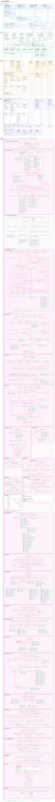

# Clickra Architecture

Welcome to the Clickra architecture repository. This directory centralizes all architectural specifications, interactive layer diagrams, and technical debt records.

---

## 🗺️ Reading Guide (新人閱讀路徑)

- ⏱️ **3-Minute Quick Visual Overview**: Open [`diagrams/overview.html`](diagrams/overview.html) to explore the system's end-to-end layered structure (L0 through L4) locally, or preview the [SVG Maps](#-github-preview-svg-maps) directly on GitHub.
- 🏛️ **System Specification & Boundaries**: Read [`spec/clickra_architecture.md`](spec/clickra_architecture.md) for canonical module ownership, Mermaid runtime topologies, and dependency rules.
- 📋 **Technical Debt & Boundary Leaks**: Check [`spec/architecture_backlog.md`](spec/architecture_backlog.md) for audited layer violations, circular dependencies, and current migration status.
- 🔄 **Regenerating Diagrams**: Run `powershell -ExecutionPolicy Bypass -File scripts\architecture\update_architecture_diagrams.ps1` from the repository root.

---

## 📂 Directory Structure

```
docs/architecture/
├── README.md               # This document (Single entry point & reading guide)
│
├── spec/                   # 🏛️ Specifications & Reports
│   ├── clickra_architecture.md       # Canonical system architecture & module invariants
│   ├── architecture_backlog.md       # 10/20 Technical debt & layer violation audit
│   └── evaluation_report_20261012.md # Initial baseline architecture evaluation
│
└── diagrams/               # 🗺️ Interactive Maps & Exports
    ├── overview.html                 # All layers (L0 to L4) interactive map
    ├── l0_entry_points.html          # L0: OS Entry points & process handoffs
    ├── l1_presentation.html          # L1: UI renderers & Presentation controllers
    ├── l2_application.html           # L2: Application use cases & task lifecycle
    ├── l3_infrastructure.html        # L3: Processors, storage, Office engines
    ├── l4_modules_internal.html      # L4: Module-internal file graphs & loop analysis
    └── svg/                          # High-resolution SVG vectors (GitHub Previewable)
```

---

## 📊 Maps: Interactive (HTML) & GitHub Direct Preview (SVG)

GitHub 不支援直接渲染 HTML 檔案（只會顯示原始碼），但**可以直接預覽原生向量 SVG**！
在本地瀏覽時推薦開 HTML 享有搜尋、高亮與縮放；在 GitHub 網頁上請直接點選 **SVG 預覽**：

| Layer | Interactive Map (Local) | GitHub Preview (SVG) | Description |
|---|---|---|---|
| **Overview** | [`diagrams/overview.html`](diagrams/overview.html) | [🖼️ `clickra_layers.svg`](diagrams/svg/clickra_layers.svg) | All layers (L0 through L4) on one canvas |
| **L0 Entry Points** | [`diagrams/l0_entry_points.html`](diagrams/l0_entry_points.html) | [🖼️ `l0_entry_points.svg`](diagrams/svg/l0_entry_points.svg) | Shell context menu, CLI, Launcher, Fluent entry points |
| **L1 Presentation** | [`diagrams/l1_presentation.html`](diagrams/l1_presentation.html) | [🖼️ `l1_presentation.svg`](diagrams/svg/l1_presentation.svg) | Screen renderers and shared Presentation controllers |
| **L2 Application** | [`diagrams/l2_application.html`](diagrams/l2_application.html) | [🖼️ `l2_application.svg`](diagrams/svg/l2_application.svg) | Application services, 19 conversion use cases |
| **L3 Infrastructure** | [`diagrams/l3_infrastructure.html`](diagrams/l3_infrastructure.html) | [🖼️ `l3_infrastructure.svg`](diagrams/svg/l3_infrastructure.svg) | Processors, storage, Office engines, external deps |
| **L4 Modules Internal** | [`diagrams/l4_modules_internal.html`](diagrams/l4_modules_internal.html) | [🖼️ `l4_inside.svg`](diagrams/svg/l4_inside.svg) | File references under `src/`, circular groups (red) |

---

## 🖼️ GitHub Direct Preview (All Layers)

> [!TIP]
> 點擊下方圖片可直接於 GitHub 開啟完整向量圖放大檢視：

[](diagrams/svg/clickra_layers.svg)

---

## 🔄 Regenerating Architecture Diagrams

Clickra diagrams are powered by Roslyn compiler semantic analysis (`scripts/architecture/SemanticGraph`). To regenerate both HTML and SVG maps:

```powershell
powershell -ExecutionPolicy Bypass -File scripts\architecture\update_architecture_diagrams.ps1
```

**Workflow:**
1. Roslyn compiles the solution and produces `semantic-msbuild.json` containing exact symbol references.
2. `file_lines.py` recalculates line counts.
3. `generate_layers.py` renders all HTML viewers and SVGs under `diagrams/` and `diagrams/svg/`.
4. The generator validates that all types and files in L0–L3 match existing code (`names ok`).
