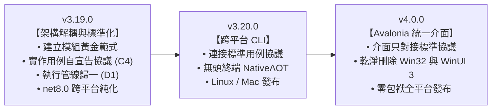

# Clickra 模組標準化與執行管線統一實施憲章 (Architecture Refactoring Manifesto)

| 欄位 | 內容 |
| :--- | :--- |
| **文件狀態** | 權威架構指導規範 (Authoritative Architecture Standard) |
| **關聯文件** | [architecture_backlog.md](architecture_backlog.md), [v4_cross_platform_unification.md](../../specs/v4_cross_platform_unification.md) |
| **制定日期** | 2026 年 11 月 |
| **目標版本** | `v3.19.0` (Core 解耦與架構歸一) $\to$ `v4.0.0` (跨平台單一介面) |

---

## 1. 執行摘要 (Executive Summary)

本憲章整合了專案過去在架構調研（`layered-architecture-diagram`）、待辦問題清單（`architecture_backlog.md`）中所識別出的深層技術債，並針對「**模組規格不一、代碼重複構建、畫面端大量硬編碼耦合**」等核心問題，提出徹底根治的工程方案。

本文件旨在作為全體工程師與 AI Agent 的共同綱領，確保後續的重構絕非「換湯不換藥的表面包裝」，而是有機械化工具守衛、有代碼淨減少量化指標的**實質架構純化**。

---

## 2. 第一部：歷史成因與認知盲點剖析（為何之前想不到？）

在探討具體解法之前，必須誠實回溯歷史，理解為何專案會一步步演化至目前的混亂狀態。這源於大型軟體在快速迭代時最常見的**三大工程盲點**：

### 2.1 盲點一：溫水煮青蛙與「局部最優解」陷阱 (Local Optimum Trap)
- **初始狀態**：Clickra 最初只是單純的 Word/圖片轉 PDF 工具。在只有 1~2 個功能時，寫一個 `if (command == "word2pdf")` 是全世界最快、最直覺、成本最低的作法。
- **演進過程**：
  - 新增「去除密碼」時，多寫 5 行 `if (command == "decrypt") promptPassword()`，省時省力，功能立刻上線。
  - 新增「PDF 分割」時，又補了 5 行 `if (command == "split-pdf") promptPages()`。
  - 新增「Markdown」時，再補上 `if (command == "md2pdf") promptMarkdown()`。
- **陷阱本質**：
  每次新增單一需求時，如果工程師提議「花兩週重寫一套通用的動態輸入協議」，在當下情境必然會被視為**過度設計（Over-engineering）**。因此每一次大家都選擇了當下改動最小、風險最低的「局部最優解」。但當這個動作重複了 15 次，累積起來就成了全局最糟糕的硬編碼蜘蛛網。

### 2.2 盲點二：跨 PR / 跨 Agent 的「防禦性孤島心態」
- 專案由不同人在不同時期的 PR 推進。任何接手單一任務（例如實作批次命名）的開發者，首要守則是：**「在自己 PR 範圍內最小改動、快點交付，千萬別動到別人的模組避免產生回歸 Bug」**。
- 這種防禦心態導致：**誰都不敢動共用的執行管線與視窗基礎架構**，只能在視窗的邊緣加入自己的私有狀態（例如 `_isPromptingBatchRename`）。每個人都完成了自己的功能，但整體架構卻持續承擔歷史包袱。

### 2.3 盲點三：微軟 WinUI 3 雙軌制帶來的精力內耗
- 專案在 3.x 前期耗費了龐大精力在解決微軟的平台問題：為追求 Fluent 視覺引進 WinUI 3，卻面臨 Windows App Runtime 無法 NativeAOT 的缺陷。
- 團隊不得不花費大量心力在 `ClickraLauncher` 轉交、雙軌打包策略、殺 surrogate host 等邊界修復上，完全被雙軌矛盾榨乾，無暇回頭審視核心模組的協議純度。

### 2.4 突破契機：三次法則（Rule of Three）與規模臨界點
> *在看過三種以上的具體實體前，過早提煉的抽象往往是錯的；但當所有極端情況都出現時，就是抽象的最佳時機。*

直到我們完成了全套規則引擎、即時差異高亮、兩階段安全置換與衝突消除（two-phase staging with best-effort rollback，而非嚴格 ACID 資料庫事務）的「批次命名」，Clickra 的 15 個模組已經窮盡了所有可能的輸入型態：
1. 完全無參數（Word, PPT, Excel）
2. 單一字串輸入（PDF 解密）
3. 數值範圍解析（PDF 分割）
4. 範本與樣式下拉（Markdown）
5. 複合規則矩陣與即時預覽（批次命名）

**所有輸入型態現已完全攤在陽光下，這正是提煉「最大公因數」的最佳時機，不再有過度設計的疑慮。**

---

## 3. 第二部：歷史架構待辦問題全盤檢視 (Debt Inventory)

本節對齊 `architecture_backlog.md` 盤點之核心技術債，並標註自 10/20 初次稽核以來的最新收斂狀態：

| 編號 | 類別 | 現象描述 | 影響範圍 | 現狀與進度 (Status) |
| :--- | :--- | :--- | :--- | :--- |
| **B2** | L0 入口 | 「要開哪個 UI / 怎麼轉交」在 `ClickraShell`、`ClickraLauncher`、`ClickraStartup` **各自寫了一份**。 | 啟動行為難以同步，存在路徑不一致風險。 | **已徹底根治**：已於 `v3.19.6.0` (Phase 7) 由 `ClickraLauncher` 統一為單一啟動路由器。 |
| **C4** | L1 畫面 | 畫面端逐一硬編碼判斷模組：各視窗充斥著 10+ 處 `if (command == "xxx")` 來決定詢問使用者何種輸入。 | **最嚴重的各自為政**。新增或修改模組需求，必須同時修改 CLI、Win32、Fluent 三個前端。 | **核心待辦**：待在 `v3.19.0` 實作用例自宣告協議徹底根治。 |
| **D1** | L2 應用 | 轉檔執行流程（Plan $\to$ ExecuteAsync）寫了三份（CLI 一套、視窗一套、翻譯一套）。 | 核心排程無法集中控管，錯誤處理與取消機制分歧。 | **已部分重構**：已提煉 `IConversionUseCase`，但執行迴圈在視窗與 CLI 仍有平行副本，待 `v3.19.0` 由 `ConversionExecutionService` 徹底統一。 |
| **E4** | L3 基礎 | 選項型別（Options）錯誤放在 `Processing/`，導致 Presentation 為了讀取選項直接跨層依賴 L3 底層。 | 破壞分層單向性，甚至引發模組內部循環引用。 | **已大部分遷移**：多數 Options 已歸位至 `Application/`，待 `v3.19.0` 加入架構守衛防回歸。 |
| **E6/E8** | L3 基礎 | 翻譯模組資料夾層級循環引用，高層 Model 與底層 Pipeline 互相依賴。 | 模組內部結構凌亂，難以單獨進行單元測試。 | **已部分解耦**：10/20 稽核中介面拆分已消除直接死鎖，待 `v3.19.0` 模組目錄標準化時全面規範。 |
| **E7** | L3 基礎 | `ClickraStorage` 拆為 11 個 partial 檔，門面呼叫 Store，Store 又引用門面定義的紀錄型別。 | 儲存層循環依賴，牽一髮動全身。 | **已徹底根治**：已於 `v3.19.5.0` (Phase 6) 抽取純契約 `TaskRecords.cs` 完成單向解耦。 |
| **E9** | 治理 | 模組沒有寫下來的共同黃金標準，缺乏自動化架構測試把關。 | 新模組結構全憑作者自律，缺乏剛性約束。 | 待在 `v3.19.0` 導入 Roslyn 架構測試作為 CI 硬性門禁。 |

---

## 4. 第三部：「真修」vs「假修」判準與落地機制

為了避免重構淪為形式主義，必須建立清晰的防偽判準：

### 4.1 拒絕「假修」（換湯不換藥的典型特徵）
- ❌ 把畫面的 `if-else` 搬到靜態 Helper 或 Switch 類別（只是將耦合轉移，新增功能依然要改它）。
- ❌ 只是建立空的 Interface 接口，底層依賴依然跨層穿透。
- ❌ 換了新的包裝名稱，但程式碼行數只增不減。

### 4.2 貫徹「真修」（四大實體機制）

#### 機制一：用例自宣告契約（Polymorphic Self-Declaration）
- **原則**：前端畫面必須是「100% 盲盒」，**嚴禁在畫面端寫出任何具體指令名稱**（如 `"md2pdf"`、`"batch-rename"`）。
- **實作**：擴充既有 `IConversionUseCase` 契約（保留既有之 Command, Plan, ExecuteAsync 等成員），增補自宣告描述：
  ```csharp
  public enum RequiredInputType { None, Password, PageRange, CustomOptions }

  public interface IConversionUseCase
  {
      // 既有基礎契約 (Existing core contract)
      string Command { get; }
      string DisplayNameKey { get; }
      IReadOnlyList<string> SupportedExtensions { get; }
      ConversionPlan Plan(ConversionContext context);
      Task<ConversionResult> ExecuteAsync(ConversionPlan plan, IProgress<ConversionProgress>? progress, CancellationToken ct);

      // v3.19.0 擴充自宣告能力 (Self-declaration extensions)
      RequiredInputType InputRequirement { get; }
      ICommandOptionDescriptor? OptionDescriptor { get; }
  }
  ```
- **畫面端行為**：只讀取 `useCase.InputRequirement`。若是 Password 就彈出共用密碼框；若是 CustomOptions 就依據 Descriptor 動態排版。
- **效益**：未來新增任何模組，**前端介面代碼 0 行改動**！

#### 機制二：單一執行管線 (Single Pipeline Engine)
- **原則**：全專案只允許存在**唯一一份**執行排程服務 `ConversionExecutionService.ExecuteAsync`。
- **實作**：
  - 統一封裝防禦檢查、前置任務建立、單檔/批次執行、取消訊號轉交、歷史寫入。
  - CLI 的 Progress 綁定終端機 ANSI 印字機。
  - GUI 的 Progress 綁定介面進度條。
  - **物理刪除** CLI 與視窗原本各自私下實作的幾百行非同步迴圈。

#### 機制三：模組標準結構與目錄規範 (Module Structure Convention)
每個 `src/Clickra.Core/Modules/{Module}/` 嚴格遵守統一規範：
1. **`Application/` (必備)**：公開接口、用例（繼承 `ConversionUseCaseBase`）、Options/Settings 型別。
2. **`Processing/` (必備)**：核心處理器（繼承 `SingleFileProcessorBase` 或 `MultiFileProcessorBase`）。
3. **`Domain/` (選用)**：純領域規則、實體、值物件（零外部相依，適用於批次命名等複雜領域模型）。
4. **`Presentation/` (選用)**：模組特化之 UI 狀態控制器（例如 `BatchRename/Presentation/BatchRenamePreviewController`），僅計算預覽排版與驗證，嚴禁依賴底層處理器。
5. **`Infrastructure/` (選用)**：模組特化之外部工具包裝或底層驅動適配。
- **歷史特例整併**：`PdfTranslation/Execution/` 為早期過渡目錄，已於 `v3.19.2.0`（Phase 3）全數遷移至 `Processing/`，全模組一律禁止出現 `Execution/`。
- **禁忌**：Options 嚴禁出現在 `Processing/`。

##### 兩層領域分類與對稱子模組標準 (Two-Tier Domain Taxonomy & Symmetrical Sub-modules)
為徹底根除專案歷史累積之粒度不對稱（如 PDF 按功能細分、Image/Office 卻多用例混裝），全專案模組架構定案採行「兩層領域分類」規範，兼具頂層整潔、領域內聚與 100% 對稱標準化：
1. **五大一級領域目錄 (`src/Clickra.Core/Modules/{Domain}/`)**：
   - **`Doc/` (文件領域)**：`Word/`, `Excel/`, `Ppt/`, `MarkdownPdf/`, `MarkdownWord/`，可設 `Shared/` 放 COM/Office/Markdown 共用底層工具與契約。
   - **`File/` (檔案組織領域)**：`BatchRename/`, `Classification/` (F2-22)。
   - **`Img/` (圖像處理領域)**：`ToPdf/`, `Compression/`, `FormatConvert/`, `Stitch/`，設 `Shared/` 放 `WicImageHelper.cs` 等專屬底層。
   - **`Pdf/` (PDF 運算領域)**：`Compression/`, `Decrypt/`, `Merge/`, `Print/`, `Split/`, `ToImage/`, `Translation/`，可設 `Shared/`。
   - **`Sys/` (系統核心領域)**：`HistoryTasks/`, `Settings/`。
2. **三道機械化防線（CI 守門測試強制約束）**：
   - **防線一（領域根層純淨）**：一級領域根目錄（如 `Modules/Img/`）嚴禁存放任何 `.cs` 散落程式碼，只能存放子目錄。
   - **防線二（領域共用封裝）**：若子目錄名為 `Shared/`（或 `Infrastructure/`），**嚴禁實作任何 `IConversionUseCase`**（只放專屬底層 Helper）；跨領域嚴禁跨層依賴（如 `Pdf` 嚴禁 reference `Img.Shared`）。
   - **防線三（功能子模組 100% 對稱）**：非 `Shared/` 的功能子目錄（如 `Img/Compression`、`Pdf/Split`），必須且只能有**剛好 1 個 `IConversionUseCase`**，並嚴格遵循 `Application/`、`Processing/` 黃金結構。
*註：本兩層領域分類標準定案於架構憲章，排定於架構重構的最終收尾階段（Final Taxonomy Polish Phase）專項批次執行，以確保主要管線與跨平台解耦之迭代穩定。*

#### 機制四：架構守衛機械化防線 (Automated Architecture Guards)
在 `tests/Clickra.Core.Tests/TestSuite.ArchitectureBoundaries.cs` 增列硬性單元測試：
- **Guard 1 (目錄白名單)**：掃描所有模組資料夾，若出現未核准之非標準資料夾（如未經註冊的 `Execution/`），測試直接 Fail。
- **Guard 2 (Options 歸位)**：掃描所有 `*Options.cs`，若不在 `Application/`，測試直接 Fail。
- **Guard 3 (分層穿透防護)**：Presentation 層若出現 `using *.Processing;`，編譯與測試直接阻斷。
- **Guard 4 (硬編碼指令禁絕)**：採用 Roslyn 語法樹與符號分析（AST & Semantic Analysis），全面掃描畫面端代碼。無論是 `==`、`.Equals(...)`、`switch` 語句、switch expression 或 pattern matching（`is "..."`），凡偵測到對具體指令 ID 的硬編碼分支，CI 直接紅燈。

---

## 5. 第四部：雙尺檢驗標準 (Verification Contract)

本次架構重構的成敗，由以下兩把客觀的「物理尺」判定：

1. **淨代碼負增長（Net-Negative LOC）**：
   - 重構完成後，由於刪除了三處重複的排程邏輯、刪除了數十個寫死的 if-else 分支，**全專案代碼行數必須呈現淨減少**。
2. **新模組零入侵（Zero-Touch Extension）**：
   - **用例發現與註冊機制**：在 NativeAOT 環境下，為杜絕執行期反射開銷與型別裁切風險，Clickra 採用編譯期 Source Generator 或自宣告註冊目錄（`ConversionUseCaseCatalog` / DI 擴充點）。新模組只需在自身命名空間完成宣告與註冊，前端畫面與共用排程器即可自動辨識。
   - **檢驗方式**：以即將開發的 `[F2-22] 檔案分類` 進行驗證。
   - **驗收標準**：在建立該模組時，**完全不需要修改既有的共用視窗類別或指令路由類別**。新模組只要自己宣告完成，前端就能自動辨識並執行。若還需要去改視窗，即宣告重構失敗！

---

## 6. 第五部：與 4.0 演進藍圖之對齊規劃

上述架構重構將直接嵌入 **第一階段（`v3.19.0`）** 的實施範疇：



透過在 v3.19.0 將地基徹底夯實，未來的 v4.0 Avalonia 介面將是輕盈且優雅的「純粹消費者」，再也不會繼承任何歷史雙軌與硬編碼技術債！
