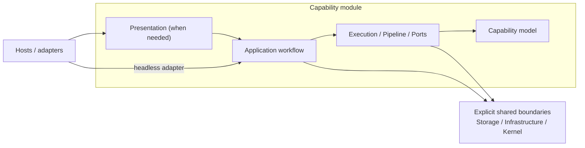
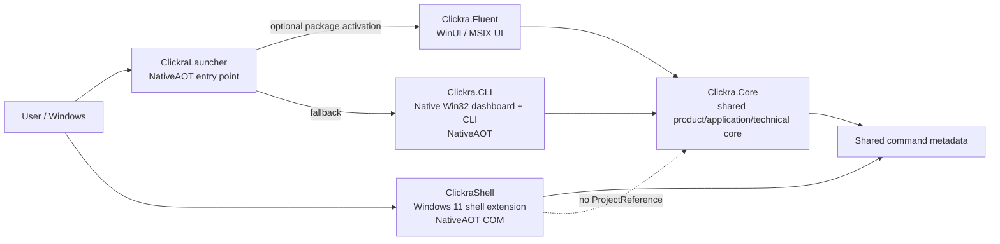
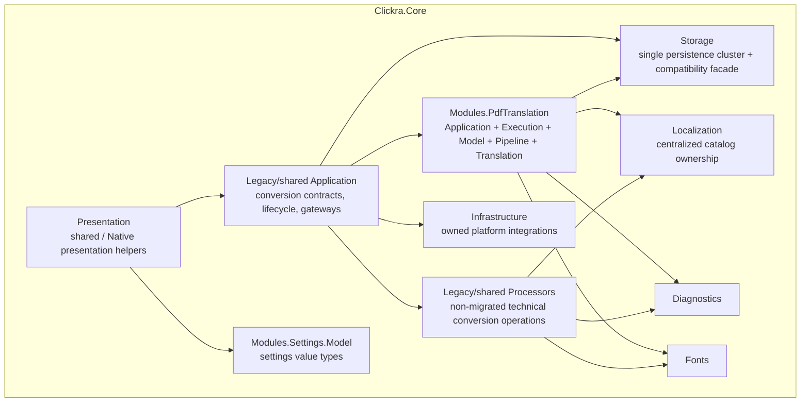
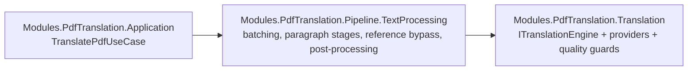
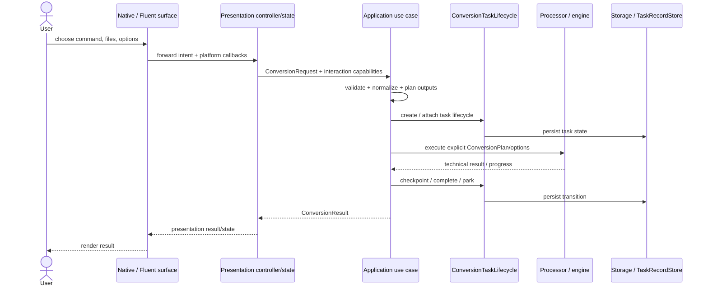
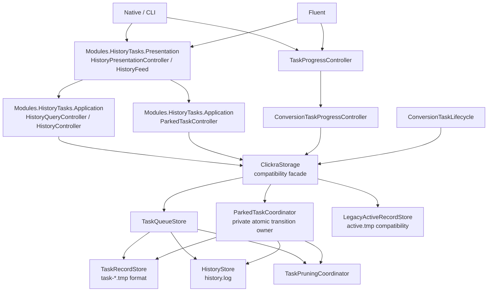
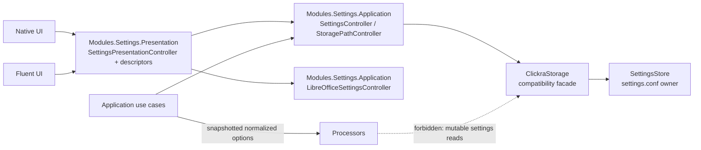

# Clickra Architecture

## 1. Purpose

This document describes Clickra's current as-built architecture after the application/storage boundary cleanup, storage decomposition, and Native/Fluent presentation consolidation.

It is the **canonical current-state architecture map** for the product. The major architecture goals are now implemented and guarded:

- application workflows have authoritative owners;
- processors are isolated from mutable presentation/storage state;
- persistence has focused storage owners;
- Convert, History, Settings, Progress, and Dashboard navigation have shared Presentation owners consumed by Native and Fluent;
- primary renderers no longer own application orchestration, storage policy, processor policy, settings schema, or duplicated screen state.

Related design records:

- `application_ui_architecture_consolidation_plan.md` — completed product/application/UI consolidation plan and rationale;
- `storage_processor_architecture_cleanup_plan.md` — completed storage, processor-state, namespace, and shared-Core cleanup track.

### Canonical as-built architecture

This is both the current implementation map and the dependency contract the repository must preserve. The primary organization axis is capability/module ownership; technical roles are local to each capability rather than global repository layers.

```mermaid
flowchart TB
    User["User / Windows"]

    subgraph Hosts["Product hosts / OS adapters"]
        Launcher["ClickraLauncher\npackage activation + Native fallback"]
        Shell["ClickraShell\nWindows shell adapter"]
        Native["Clickra.CLI\nNative Win32 renderer + CLI adapter"]
        Fluent["Clickra.Fluent\nWinUI renderer + platform adapters"]
    end

    subgraph Shared["Shared / not-yet-migrated Core boundaries"]
        SharedPresentation["Presentation\nConvert / Progress / Dashboard"]
        SharedApplication["Application\nconversion contracts, lifecycle, gateways"]
        SharedProcessors["Processors\nremaining PDF tools"]
    end

    subgraph Pdf["Modules/PdfTranslation"]
        PdfApplication["Application\nTranslatePdfUseCase"]
        PdfExecution["Execution\nPdfTranslateProcessor"]
        PdfModel["Model"]
        PdfPipeline["Pipeline\nanalysis / layout / rendering / text processing"]
        PdfProviders["Translation\nprovider engines + fallback policy"]
        PdfApplication --> PdfExecution
        PdfExecution --> PdfPipeline
        PdfPipeline --> PdfModel
        PdfPipeline --> PdfProviders
    end

    subgraph PdfCompression["Modules/PdfCompression"]
        PdfCompressionApplication["Application\nCompressPdfUseCase"]
        PdfCompressionProcessing["Processing\noptions / engine / optimizer / processor"]
        PdfCompressionApplication --> PdfCompressionProcessing
    end

    subgraph PdfDecrypt["Modules/PdfDecrypt"]
        PdfDecryptApplication["Application\nDecryptPdfUseCase"]
        PdfDecryptProcessing["Processing\nPdfDecryptProcessor"]
        PdfDecryptApplication --> PdfDecryptProcessing
    end

    subgraph PdfMerge["Modules/PdfMerge"]
        PdfMergeApplication["Application\nMergePdfUseCase"]
        PdfMergeProcessing["Processing\nPdfMergeProcessor"]
        PdfMergeApplication --> PdfMergeProcessing
    end

    subgraph PdfSplit["Modules/PdfSplit"]
        PdfSplitPresentation["Presentation\nVisualSplitModel"]
        PdfSplitApplication["Application\nSplitPdfUseCase / PdfPageCountQuery"]
        PdfSplitProcessing["Processing\nPdfSplitProcessor"]
        PdfSplitPresentation --> PdfSplitProcessing
        PdfSplitApplication --> PdfSplitProcessing
    end

    subgraph ImageModule["Modules/Image"]
        ImageApplication["Application\nformat / compression / stitch / merge / img2pdf"]
        ImageProcessing["Processing\nWIC / format conversion / compression / stitching / PDF"]
        ImageApplication --> ImageProcessing
    end

    subgraph OfficeModule["Modules/Office"]
        OfficeApplication["Application\nWord / Excel / PowerPoint to PDF"]
        OfficeProcessing["Processing\nOffice options + per-app processors"]
        OfficeInfrastructure["Infrastructure\nMicrosoft automation / LibreOffice runtime + installer"]
        OfficeApplication --> OfficeProcessing
        OfficeProcessing --> OfficeInfrastructure
    end

    subgraph Settings["Modules/Settings"]
        SettingsPresentation["Presentation\nSettingsPresentationController + descriptors"]
        SettingsApplication["Application\nSettingsController / StoragePathController /\nLibreOfficeSettingsController"]
        SettingsModel["Model\nNumericSettingRange"]
        SettingsPresentation --> SettingsApplication
        SettingsApplication --> SettingsModel
    end

    subgraph HistoryTasks["Modules/HistoryTasks"]
        HistoryPresentation["Presentation\nHistoryPresentationController / HistoryFeed"]
        HistoryApplication["Application\nHistoryController / HistoryQueryController /\nParkedTaskController"]
        HistoryPresentation --> HistoryApplication
    end

    subgraph Markdown["Modules/Markdown"]
        MarkdownApplication["Application\nMarkdownToPdfUseCase / MarkdownToWordUseCase"]
        MarkdownProcessing["Processing\nrender profiles / templates / PDF + DOCX backends"]
        MarkdownApplication --> MarkdownProcessing
    end

    subgraph SharedTechnical["Shared technical / platform boundaries"]
        Fonts["Fonts"]
        Diagnostics["Diagnostics"]
        Localization["Localization"]
    end

    subgraph Storage["Storage persistence SCC"]
        Compat["ClickraStorage\ncompatibility facade"]
        PersistenceOwners["Settings / History / Task records /\nParked transitions / Retention / Legacy active"]
        Runtime["StorageRuntime"]
        Compat --> PersistenceOwners
        PersistenceOwners --> Runtime
    end

    subgraph Files["Physical persistence"]
        SettingsFile["settings.conf"]
        HistoryFile["history.log"]
        TaskFiles["task-*.tmp"]
        LegacyFile["active.tmp"]
    end

    User --> Launcher
    User --> Shell
    Launcher --> Fluent
    Launcher --> Native
    Shell -->|"command/arguments only"| Native

    Native --> SharedPresentation
    Fluent --> SharedPresentation
    Native --> SettingsPresentation
    Fluent --> SettingsPresentation
    Native --> HistoryPresentation
    Fluent --> HistoryPresentation
    Native --> PdfSplitPresentation
    Fluent --> PdfSplitPresentation
    Native -->|"headless CLI only"| SharedApplication

    SharedPresentation --> SharedApplication
    SharedApplication --> SharedProcessors
    SharedApplication --> PdfApplication
    SharedApplication --> PdfCompressionApplication
    SharedApplication --> PdfDecryptApplication
    SharedApplication --> PdfMergeApplication
    SharedApplication --> PdfSplitApplication
    SharedApplication --> ImageApplication
    SharedApplication --> OfficeApplication
    SharedApplication --> MarkdownApplication
    SharedApplication --> SettingsApplication
    SharedApplication --> Storage
    SharedProcessors --> SharedTechnical
    PdfPipeline --> SharedTechnical
    PdfCompressionProcessing --> SharedTechnical
    MarkdownProcessing --> SharedTechnical
    SettingsApplication --> Storage
    SettingsApplication --> OfficeInfrastructure
    HistoryApplication --> Storage

    Storage --> SettingsFile
    Storage --> HistoryFile
    Storage --> TaskFiles
    Storage --> LegacyFile
```

The repository is therefore **module-first, not globally layer-first**. Dependency roles still
matter, but they are local to the owning capability. For example, Settings has
`Presentation -> Application -> Storage/Infrastructure`, while PDF Translation has
`Application -> Execution -> Pipeline/Translation`. Headless CLI may enter an Application boundary
directly because it is an adapter rather than a screen renderer.

Global invariants are smaller and stronger:

1. product hosts stay at the edge;
2. a capability owns its private workflow/model/technical code;
3. module-to-module dependencies are intentional rather than accidental shared-bucket coupling;
4. persistence and external/platform integration stay behind narrow owners;
5. multiple UI renderers of the same product screen share one Presentation state/model;
6. each conversion use case retains one authoritative Application workflow.

---

## 2. Architecture in one sentence

> **Clickra is a feature-oriented modular monolith: thin hosts call capability modules; each capability owns its workflow, model, presentation, and technical roles as needed; shared persistence and platform boundaries stay narrow and explicit.**

Layering remains useful **inside** a capability, but it is no longer the primary repository
organization:

Capabilities do not need identical internal folders. Empty symmetry is explicitly avoided. Shared
code is extracted only when it is genuinely capability-neutral rather than merely reused by two
call sites.

---
## 3. Product and executable boundaries

Clickra is not one executable. It has several product entry points with intentionally different responsibilities.

### Project responsibilities

| Project | Responsibility | Important boundary |
| --- | --- | --- |
| `ClickraLauncher` | Zero/low-dependency packaged entry point that activates Fluent when available and falls back to the Native dashboard | Does not become a product workflow owner |
| `Clickra.Fluent` | WinUI/MSIX presentation and platform interaction | References `Clickra.Core`; must not own a second conversion workflow |
| `Clickra.CLI` | Native dashboard, quiet/CLI surface, Native progress and platform adapters | References `Clickra.Core`; must not bypass application owners |
| `ClickraShell` | Thin Windows 11 modern-menu COM shell extension | Intentionally does **not** reference full `Clickra.Core`; preserve NativeAOT boundary |
| `Clickra.Core` | Product/application workflows, processors, persistence boundaries, translation services, shared presentation infrastructure | Must remain UI-technology independent at the application-contract level |

---

## 4. `Clickra.Core` modules and bounded contexts

The Core assembly is shared for deployment and NativeAOT reasons, but repository ownership is capability-first. New product code belongs under `Modules/<Capability>/...`; technical roles are secondary inside the owning capability. The old top-level `Application`, `Presentation`, `Processors`, `Storage`, and `Models` directories are shrinking migration buckets rather than the target organization.

### Meaning of the major boundaries

#### Shared Application kernel and migrating use cases

`Clickra.Core.Application` remains the shared workflow kernel while capability-owned use cases move under their modules. Important shared owners include:

- conversion contracts and the use-case registry;
- shared conversion orchestration and registries;
- `ConversionRequest`, `ConversionPlan`, and `ConversionResult`;
- `ConversionTaskLifecycle` for application-level task creation/completion/parking orchestration;
- `ConversionTaskProgressController` for progress-index persistence, including compatibility writes.

The PDF translation use case has migrated to `Modules.PdfTranslation.Application.TranslatePdfUseCase`; PDF compression has migrated to `Modules/PdfCompression`; PDF decryption has migrated to `Modules/PdfDecrypt`; PDF merging has migrated to `Modules/PdfMerge`; PDF splitting has migrated to `Modules/PdfSplit`; image conversion has migrated to `Modules/Image`; Office conversion has migrated to `Modules/Office`; Markdown document conversion has migrated to `Modules.Markdown`; settings gateways have migrated to `Modules.Settings.Application`; history/parked-task query and action gateways have migrated to `Modules.HistoryTasks.Application`. These continue to consume shared contracts where appropriate. UI surfaces still ask these owners to perform product operations instead of coordinating persistence or processor behavior themselves.

#### PDF Translation module

`Modules/PdfTranslation` is the first migrated vertical capability:

- `Application/` — authoritative `TranslatePdfUseCase`;
- `Execution/` — `PdfTranslateProcessor`, adapting the shared processor execution contract;
- `Model/` — PDF paragraph, annotation, rendering, and diagnostics models that were previously misleadingly placed in the repository-wide `Models` bucket;
- `Pipeline/` — PDF-specific analysis, layout, table/diagram detection, rendering, and `TextProcessing`;
- `Translation/` — translation provider engines, fallback, timeout, and result-quality policy.

Provider infrastructure and PDF text processing remain distinct namespaces inside the same capability. This keeps their different responsibilities visible without pretending they belong to unrelated top-level layers.

Shared `Fonts`, `Rendering`, `Localization`, and `Diagnostics` remain outside the module because semantic dependency analysis shows real consumers outside PDF translation.

#### PDF Compression module

`Modules/PdfCompression` owns the cohesive PDF compression slice selected by semantic dependency locality:

- `Application/CompressPdfUseCase` — authoritative planning, saved-option snapshot, validation, and execution workflow;
- `Processing/PdfCompressionOptions` and `PdfCompressionLevel` — the shared compression preset contract used by product surfaces and processing;
- `Processing/PdfCompressionSettings`, `PdfCompressionEngine`, and `PdfStructuralCompressionOptimizer` — compression policy and native PDF optimization implementation;
- `Processing/PdfCompressionProcessor` — the capability-specific adapter over the shared single-file processor base.

Shared conversion contracts, `FileProcessor`, generic processor base/progress helpers, Fonts, and Settings remain outside the module because they have real non-PDF-compression consumers. The move changes ownership and namespace boundaries only; compression presets, output planning, saved settings behavior, and NativeAOT execution remain unchanged.

#### PDF Decrypt module

`Modules/PdfDecrypt` owns the password-removal workflow and its PDF processor. The use case remains the authoritative owner of password interaction, planning, saved execution language, and task behavior; the processor remains responsible for opening and rewriting the PDF.

Shared interaction/contracts, localization execution options, `FileProcessor`, Settings, and generic single-file/progress helpers remain outside the module. The ownership move does not change password retry behavior, output naming, exception semantics, or NativeAOT behavior.

#### PDF Merge module

`Modules/PdfMerge` owns the single-output PDF merge workflow and its processor. The application owner keeps output planning, collision semantics, and task behavior authoritative while the processor owns page aggregation.

Shared conversion contracts, `FileProcessor`, and the generic multi-file processor base remain outside the capability. The ownership move does not change input ordering, output naming, overwrite safety, or NativeAOT behavior.

#### PDF Split module

`Modules/PdfSplit` owns the PDF split workflow and the shared visual-splitter state used by both renderers:

- `Application/SplitPdfUseCase` — authoritative planning and execution workflow;
- `Application/PdfPageCountQuery` — presentation-safe page-count query boundary;
- `Processing/PdfSplitProcessor` — PDF page extraction and segment-spec execution;
- `Presentation/VisualSplitModel` — pure shared Native/Fluent splitter state, selection, segment editing, and zoom behavior.

The semantic graph shows this slice has no domain-specific outgoing dependencies once the shared conversion kernel and processor base helpers are excluded. The Native and Fluent visual splitters render and wire input independently, but both consume the same `VisualSplitModel`. Shared conversion contracts, `FileProcessor`, generic processor base/progress helpers, and rendering helpers remain outside the module. The ownership move does not change split specs, page-count semantics, output naming, interaction flow, or NativeAOT behavior.

#### Image module

`Modules/Image` owns image format conversion, compression, stitching, image-to-PDF, and image merge workflows together with their shared WIC/output-safety implementation. Keeping these together avoids artificial cross-module coupling around `WicImageHelper`, `ImageFormatConvertProcessor`, and `ImageOutputSafety`.

Shared conversion contracts, `FileProcessor`, generic multi-file execution/localization helpers, Settings, and Localization remain outside the capability because they have consumers beyond image conversion. The move preserves codec checks, saved compression settings, output collision safety, image orientation/multi-frame guards, and NativeAOT behavior.

#### Office module

`Modules/Office` owns the complete Office-to-PDF capability:

- `Application/OfficeToPdfUseCaseBase` plus the Word, Excel, and PowerPoint use cases — authoritative planning, saved engine settings, task lifecycle integration, and execution workflow;
- `Processing/OfficeConversionOptions` plus the per-application processors — normalized execution inputs and processor adapters;
- `Infrastructure/PowerShellHelper`, `OfficeEngineDetector`, and `LibreOfficeHelper` — Microsoft Office automation, engine readiness/fallback policy, and LibreOffice execution;
- `Infrastructure/LibreOfficeEngineInstaller` — LibreOffice installation/adoption/removal infrastructure used by the Settings capability.

Settings may depend on Office infrastructure for LibreOffice management and readiness, but generic conversion contracts, `FileProcessor`, `SingleFileProcessorBase`, `ProcessorExecutionOptions`, lifecycle storage, and localization remain shared. The installer retains its existing explicit per-owner settings allowlist; moving the owner does not change settings keys, management identity, install/uninstall semantics, fallback policy, or NativeAOT behavior.

#### Markdown module

`Modules/Markdown` owns the cohesive Markdown document-conversion slice selected by semantic dependency locality:

- `Application/MarkdownConversionUseCaseBase`, `MarkdownToPdfUseCase`, and `MarkdownToWordUseCase` — authoritative planning and execution workflows;
- `Processing/MarkdownPdfOptions` and `MarkdownRenderProfile` — normalized renderer-neutral conversion/presentation options;
- `Processing/MarkdownDocumentTemplate`, template loaders, layout/palette helpers, and table sizing — shared PDF/DOCX rendering policy;
- `Processing/MarkdownToPdfProcessor`, `MarkdownToWordProcessor`, and `MarkdownSingleFileProcessorBase` — Markdown-specific execution backends.

Shared conversion contracts, `FileProcessor`, generic processor execution/localization helpers, `Fonts`, and Settings remain outside the module because they have real non-Markdown consumers. The move changes ownership and namespace boundaries only; PDF/DOCX output semantics, NativeAOT behavior, and interactive option flow remain unchanged.

#### Settings module

`Modules/Settings` owns the product-facing settings capability without splitting persistence out of the shared Storage SCC:

- `Application/SettingsController` — typed settings gateway;
- `Application/StoragePathController` — application-facing output-path resolution;
- `Application/LibreOfficeSettingsController` — LibreOffice settings/lifecycle gateway;
- `Application/SettingsContract` — presentation-neutral setting names and scalar metadata;
- `Presentation/SettingsPresentationController` and `SettingDescriptor` — shared Native/Fluent settings-screen state and schema;
- `Model/NumericSettingRange` — settings-specific value type.

`ClickraSettings`, `SettingsStore`, and `StoragePathResolver` intentionally remain in `Clickra.Core.Storage` because the semantic SCC shows persistence is one coupled compatibility boundary. Moving application/presentation ownership does not authorize changing settings keys, file formats, caching, mutex behavior, or watcher semantics.

#### HistoryTasks module

`Modules/HistoryTasks` owns the safe application/presentation boundary around history and parked-task actions:

- `Application/HistoryQueryController` — immutable history/task query facts;
- `Application/HistoryController` — completed-history actions/path access;
- `Application/ParkedTaskController` — parked-task retention/cancel/resume gateway;
- `Presentation/HistoryPresentationController` and `HistoryFeed` — authoritative Native/Fluent History screen state, wording, and available actions.

This migration intentionally stops at the lifecycle boundary. `ConversionTaskLifecycle`, `ConversionTaskProgressController`, `ConversionTaskCleanup`, `TaskProgressController`, task-record persistence, `ParkedTaskCoordinator`, and legacy `active.tmp` compatibility remain in their existing owners until a separate evidence-backed migration proves they can move without changing resume identity, atomic transitions, retention, or compatibility semantics.

#### Legacy/shared Processors

The remaining `Clickra.Core.Processors` bucket owns technical mechanics that have not yet migrated to capability modules. Processors receive explicit, already-normalized execution inputs from application code. Existing guards continue to prevent hidden mutable settings/storage access.

#### Storage

`Clickra.Core.Storage` owns persistence details rather than product presentation behavior.

MSBuild/Roslyn dependency analysis shows these persistence files form one strongly connected cluster. They therefore remain one persistence boundary during the module-first migration rather than being split into artificial Settings/History/Task modules merely to mirror filenames.

Important ownership includes:

- `StorageRuntime` — data paths, the shared file lock, and the historical cross-process mutex contract;
- `SettingsStore` — `settings.conf` caching, persistence, freshness, watcher synchronization, and change events;
- `StoragePathResolver` — persisted output-directory policy to filesystem-path resolution;
- `HistoryStore` — `history.log` parsing and append/delete behavior;
- `TaskRecordStore` — the `task-*.tmp` file format and record I/O;
- `TaskQueueStore` — normal task lifecycle persistence over task records;
- `LegacyActiveRecordStore` — the preserved `active.tmp` compatibility format and lifecycle;
- `ParkedTaskCoordinator` — private/internal owner of parked-task atomic transitions;
- `TaskPruningCoordinator` / `TaskRetentionPolicy` — stale-task cleanup and retention policy;
- `ClickraStorage.*` — a compatibility facade that delegates to those focused owners rather than containing their implementations.

`ParkedTaskCoordinator` is intentionally not a presentation/application API. Storage returns retention facts through `Modules.HistoryTasks.Application`; localized retention wording is owned by `Modules.HistoryTasks.Presentation.HistoryFeed` with an explicit language input.

#### Translation providers versus PDF text processing

The two translation-related contexts are deliberately separate:

`Modules.PdfTranslation.Translation` is provider/engine infrastructure. `Modules.PdfTranslation.Pipeline.TextProcessing` is the PDF-specific text-processing pipeline. The ambiguous `Pipeline/Translation` context is explicitly guarded against returning.

#### Infrastructure

Infrastructure owns platform integrations only when ownership is explicit. For example, `LibreOfficeEngineInstaller` may persist the small allowlisted set of LibreOffice lifecycle keys it owns.

Infrastructure persistence is guarded by a per-file/key allowlist rather than being a generic escape hatch from application ownership.

#### Presentation helpers inside Core

Presentation code is intentionally shared in the Core assembly so Native and Fluent render one product state:

- `Presentation.Convert.ConvertWorkspaceController` — command catalog, selection, compatibility, validation, and run-state owner;
- `Presentation.Convert.ConversionExecutionController` — presentation-facing execution session over the Application use-case layer;
- `Modules.HistoryTasks.Presentation.HistoryPresentationController` / `HistoryFeed` — history/task state, derived wording, retention presentation, and available actions;
- `Modules.Settings.Presentation.SettingsPresentationController` / `SettingDescriptor` — settings screen state, descriptors, bounds, and LibreOffice presentation actions;
- `Presentation.Progress.TaskProgressController` — semantic progress and terminal-state owner;
- `Presentation.Dashboard.DashboardPresentationController` — semantic dashboard navigation state;
- `Presentation.Native.DashboardLayout` / `HistoryLayout` — testable Native presentation geometry;
- `Presentation.Shared.VectorIcons` — single-source presentation geometry shared across UI technologies.

Their presence in the Core assembly does not make them domain/application logic; their namespaces make that ownership explicit.

---

## 5. Conversion workflow

Every migrated conversion command has one authoritative application use-case owner, reached by UI renderers through the shared Presentation execution owner.

### Ownership rule

The UI may provide platform-specific capabilities (password prompt, visual page splitter, notifications, dialogs), but Presentation owns screen semantics and the shared Application use case owns the workflow in which those capabilities are used.

In other words:

> **Inject platform differences into one workflow; do not fork the workflow by UI technology.**

---

## 6. Task, history, resume, and persistence flow

Task persistence intentionally has more than one internal component, but each has a narrow owner.

Preserved behavior includes:

- task-record formats;
- parked-task atomic claim/cancel transitions;
- resume identity/index semantics;
- retention semantics;
- legacy `active.tmp` compatibility;
- best-effort progress-index writes required by compatibility behavior.

---

## 7. Settings flow

Settings is now a capability module. Its Application subcontext owns typed gateways, its Presentation subcontext owns screen schema/state, and persistence remains in the shared Storage SCC. Persisted keys and string encodings stop below the module-facing boundaries.

CLI and Fluent consume `Modules.Settings.Presentation.SettingsPresentationController` plus module-owned `SettingDescriptor` metadata. They do not call raw Storage settings APIs, interpret persisted `"true"` / `"false"` strings, or know `ClickraSettings` keys/ranges. Application use cases consume the typed `Modules.Settings.Application` gateways and snapshot normalized options before processor execution, preventing a conversion from silently changing behavior mid-run because a processor rereads mutable global settings.

---

## 8. Architecture guardrails

Architecture is enforced by tests, not only by documentation.

The current architecture-boundary test suite pins, among other rules:

- UI/application violation baseline: **0**;
- processor global-state baseline: **0**;
- processors do not depend on `ClickraStorage`;
- infrastructure settings access stays on an explicit allowlist;
- application contracts stay UI-independent;
- settings persistence has one application gateway;
- presentation settings use one shared Presentation owner and Presentation-owned descriptor catalog;
- parked-task actions have one application gateway;
- presentation code does not depend on raw `ClickraStorage`;
- primary Native/Fluent renderers depend on shared Presentation owners rather than directly orchestrating Application/Processor/Infrastructure policy;
- `Clickra.Core.Presentation` depends inward through Application contracts and presentation-neutral shared models, not Storage/Processors/Infrastructure implementation details;
- `ConvertCommandRegistry` belongs to Application rather than Processors;
- the `ClickraStorage` compatibility facade delegates persistence implementation to focused storage owners;
- storage code does not own localized presentation wording;
- Core bounded contexts declare their owned namespaces;
- presentation/platform helpers have explicit ownership;
- translation provider and PDF text-processing contexts stay distinct;
- each migrated conversion workflow has a single execution owner;
- duplicate use-case ownership is rejected.

Important prohibited regressions include:

- reintroducing `ConvertCommandRunner` as a parallel workflow owner;
- reintroducing `ConvertCommandRegistry.EstimateOutputs`;
- adding Native/Fluent legacy conversion fallback paths;
- adding a new Native `switch(command)` execution router;
- making UI surfaces own task lifecycle transitions or raw output planning;
- exposing `ParkedTaskCoordinator` as an application/UI service;
- adding full `Clickra.Core` as a dependency of `ClickraShell` merely for code sharing.

---

## 9. Architecture completion status

### Completed and strongly guarded

The following architecture areas are implemented and guarded in the current codebase:

1. **One application execution owner for migrated conversion commands.**
2. **Processor isolation from mutable storage/settings state.**
3. **Typed/narrow application gateways for settings, parked tasks, history, storage paths, task progress, and task lifecycle.**
4. **Focused storage owners for settings, paths, history, task records/lifecycle, retention/pruning, and legacy compatibility; `ClickraStorage` is a compatibility facade rather than the implementation owner.**
5. **Capability-first Core ownership:** PDF Translation now lives under `Modules/PdfTranslation`, Settings has begun migrating under `Modules/Settings`, and shared Storage/Infrastructure/Diagnostics/Fonts boundaries remain explicit.
6. **One authoritative Presentation owner for the major product screens:** Convert, History/Tasks, Settings, Progress, and Dashboard navigation.
7. **Presentation-owned derived state and UI schema:** command grouping/compatibility/validation, history wording/retention state, settings descriptors/bounds, and progress semantics are not duplicated by Native and Fluent.
8. **Thin primary renderers:** Native Dashboard and Fluent MainPage/TaskProgressPage forward intent and render shared state rather than directly orchestrating use cases, storage, Office/LibreOffice policy, or settings schema.
9. **NativeAOT boundaries for CLI, Launcher, and Shell remain intentional.**
10. **Zero architecture-violation and processor-global-state baselines for the guarded legacy patterns.**

The definition of done from `application_ui_architecture_consolidation_plan.md` is therefore satisfied:

> **One Product Model + One Application Workflow per Use Case + One Presentation State per Screen + Multiple Thin UI Renderers**

This does not mean the repository can never need future architecture work. New product areas can introduce new boundaries, and existing implementation details can still be improved. It means the architecture consolidation project described by the two development plans is complete: the intended ownership graph is now represented by production code and protected by automated guards.

Local completion evidence for this consolidation slice:

- 5 product warnings-as-errors builds plus the test project: 0 warnings / 0 errors;
- 79 architecture/localization guards: 79 passed, 0 failed, 0 skipped;
- 352 functional tests: 352 passed, 0 failed, 0 skipped;
- fixture-required full runner: 431 passed, 0 failed, 0 skipped;
- 34 Store publishing unit tests passed;
- product icon asset verification passed;
- NativeAOT publish succeeded for CLI, ClickraShell, and ClickraLauncher.

---

## 10. Contributor dependency checklist

Before adding a new feature, determine its owner in this order:

1. **Which product capability owns the change?** New Core product code is organized capability-first under Modules/<Capability>/...; technical role is the second axis. See module_first_architecture_decision.md.
2. **Is it product workflow policy?** Keep it in that capability's application workflow, not in Native or Fluent.
3. **Is it a technical conversion operation?** Keep it with the owning capability and pass explicit execution inputs.
4. **Is it persistence?** Keep it behind the owning capability's application/persistence boundary; do not expose raw persistence to presentation.
5. **Is it platform interaction?** Implement a platform adapter/capability and inject it into the shared workflow.
6. **Is it visual rendering/layout only?** It may remain surface-specific, or shared under explicit presentation ownership when single-source behavior is valuable.
7. **Is it Windows shell/packaging behavior?** Preserve the dedicated Launcher/Shell/Infrastructure boundary instead of pulling the full Core graph into it.

When in doubt, dependency direction should continue to point inward from Renderer to Presentation to Application and then to technical/storage owners, never outward from Core into a UI technology.

The existing top-level Application, Presentation, Processors, Storage, and Models directories are a shrinking migration baseline, not the preferred location for new feature-private files. Architecture guards prevent those generic buckets from expanding and prevent technical-role names from becoming the first axis under Modules.

---

## 11. Maintenance rule

Update this document when a change alters a real ownership or dependency boundary. Do not update it for cosmetic file moves that do not change architecture.

For detailed migration history and rationale, keep the architecture plans as the decision records; this file should remain the concise map of the architecture that a new contributor can understand first.
