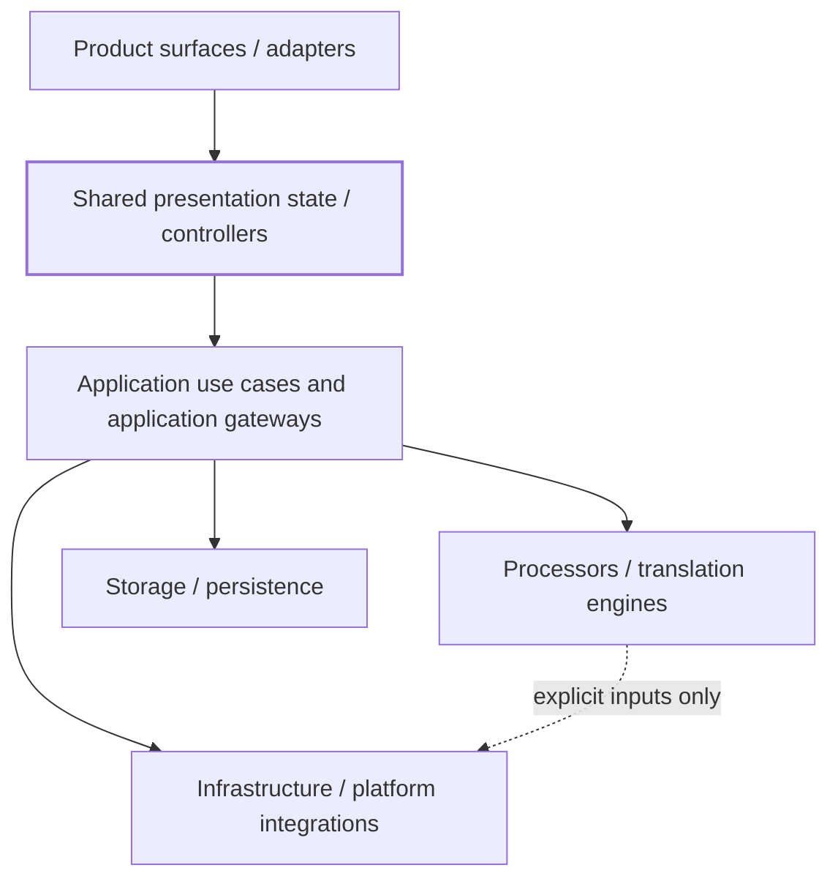
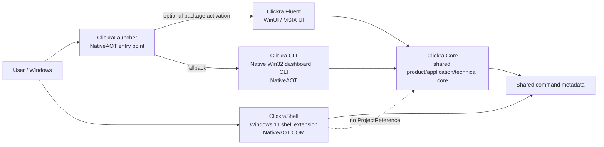
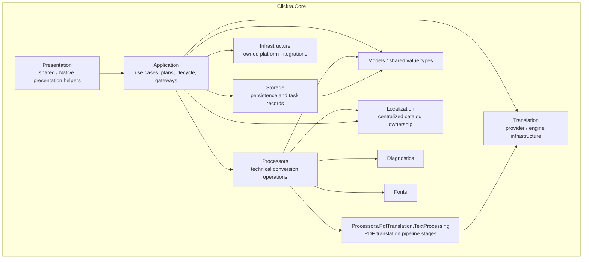
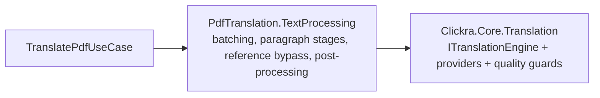
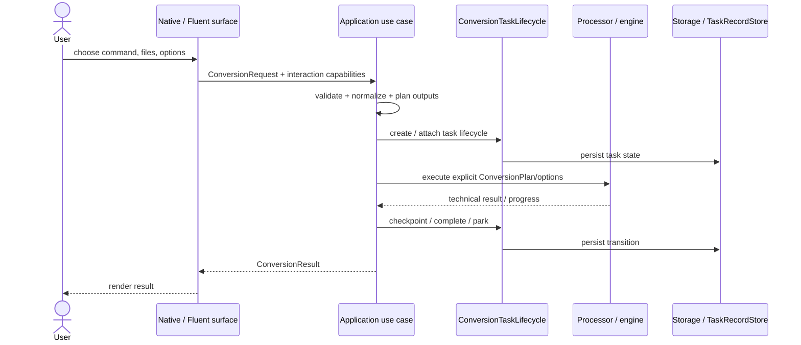
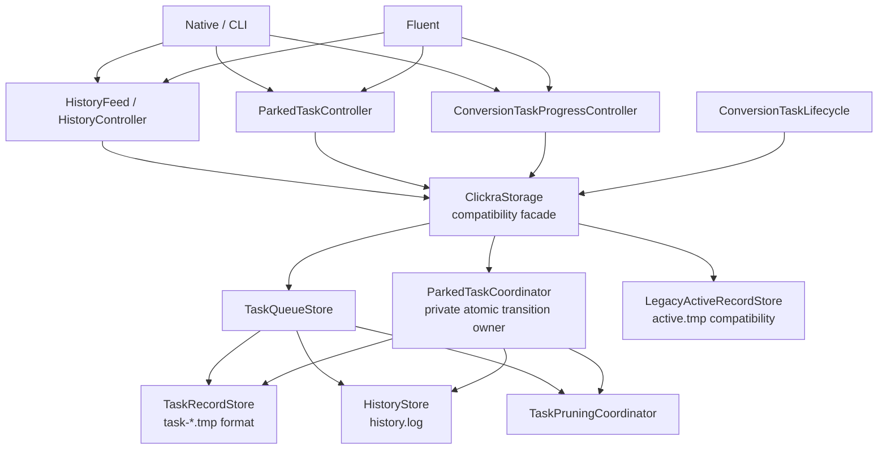
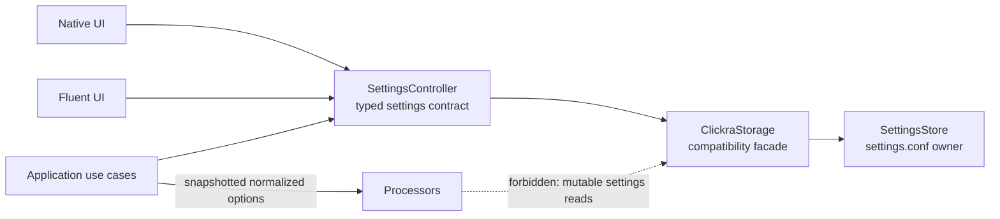

# Clickra Architecture

## 1. Purpose

This document describes Clickra's current architecture after the application/storage boundary cleanup and the subsequent decomposition of the historical `ClickraStorage` implementation.

It is intentionally a **current-state architecture map**, not a claim that Clickra has no remaining architecture work. In particular:

- backend workflow ownership, typed settings access, processor isolation, storage ownership, and major Core bounded contexts are now explicit and guarded;
- the remaining product-level architecture goal is the presentation consolidation described in `application_ui_architecture_consolidation_plan.md`: one authoritative presentation state/controller per major screen, consumed by thin Native and Fluent renderers.

Related design records:

- `application_ui_architecture_consolidation_plan.md` — product/application/UI target and remaining presentation-consolidation work;
- `storage_processor_architecture_cleanup_plan.md` — completed storage, processor-state, namespace, and shared-Core cleanup track.

---

## 2. Architecture in one sentence

> **Thin product surfaces call shared application workflows; application workflows own product behavior; processors perform technical conversion work; storage owns persistence; platform-specific code stays at the edges.**

The intended dependency direction is one-way:

The `Presentation` layer in this diagram is the architectural target for shared product state. Some shared presentation ownership already exists, but full per-screen consolidation remains tracked separately.

---

## 3. Product and executable boundaries

Clickra is not one executable. It has several product entry points with intentionally different responsibilities.

### Project responsibilities

| Project | Responsibility | Important boundary |
| --- | --- | --- |
| `ClickraLauncher` | Zero/low-dependency packaged entry point that activates Fluent when available and falls back to the Native dashboard | Does not become a product workflow owner |
| `Clickra.Fluent` | WinUI/MSIX presentation and platform interaction | References `Clickra.Core`; must not own a second conversion workflow |
| `Clickra.CLI` | Native dashboard, quiet/CLI surface, Native progress and platform adapters | References `Clickra.Core`; must not bypass application owners |
| `ClickraShell` | Thin Windows 11 modern-menu COM shell extension | Intentionally does **not** reference full `Clickra.Core`; preserve NativeAOT boundary |
| `Clickra.Core` | Product/application workflows, processors, persistence boundaries, translation services, shared presentation infrastructure | Must remain UI-technology independent at the application-contract level |

---

## 4. `Clickra.Core` bounded contexts

The Core assembly is shared for deployment and NativeAOT reasons, but it is no longer treated as one flat responsibility bucket.

### Meaning of the major boundaries

#### Application

`Clickra.Core.Application` is the authoritative owner for user-visible workflows and persistence-facing application actions. Important examples include:

- conversion use cases such as `CompressPdfUseCase`, `SplitPdfUseCase`, `DecryptPdfUseCase`, image, Markdown, Office, merge, and translation workflows;
- `ConversionRequest`, `ConversionPlan`, and `ConversionResult`;
- `ConversionTaskLifecycle` for application-level task creation/completion/parking orchestration;
- `SettingsController` for typed application settings access; presentation code does not consume persisted setting keys or boolean string encodings directly;
- `ParkedTaskController` for parked-task actions and atomic resume claims;
- `HistoryFeed` / `HistoryController` for application-owned history views/actions;
- `StoragePathController` for application-facing storage path resolution;
- `ConversionTaskProgressController` for progress-index persistence, including compatibility writes.

The UI should ask these owners to perform product operations instead of coordinating persistence or processor behavior itself.

#### Processors

Processors own technical conversion mechanics. They receive explicit, already-normalized execution inputs from application code.

Current architecture guards enforce:

- no direct `ClickraStorage` dependency from `src/Clickra.Core/Processors/**`;
- no hidden mutable global-setting reads inside processors;
- localization-sensitive processor behavior receives an explicit execution language;
- processors do not depend on Fluent or Native UI technology.

#### Storage

`Clickra.Core.Storage` owns persistence details rather than product presentation behavior.

Important ownership includes:

- `StorageRuntime` — data paths, the shared file lock, and the historical cross-process mutex contract;
- `SettingsStore` — `settings.conf` caching, persistence, freshness, watcher synchronization, and change events;
- `StoragePathResolver` — persisted output-directory policy to filesystem-path resolution;
- `HistoryStore` — `history.log` parsing and append/delete behavior;
- `TaskRecordStore` — the `task-*.tmp` file format and record I/O;
- `TaskQueueStore` — normal task lifecycle persistence over task records;
- `LegacyActiveRecordStore` — the preserved `active.tmp` compatibility format and lifecycle;
- `ParkedTaskCoordinator` — private/internal owner of parked-task atomic transitions;
- `TaskPruningCoordinator` / `TaskRetentionPolicy` — stale-task cleanup and retention policy;
- `ClickraStorage.*` — a compatibility facade that delegates to those focused owners rather than containing their implementations.

`ParkedTaskCoordinator` is intentionally not a presentation/application API. Storage returns retention facts; localized retention wording is owned by `Application/HistoryFeed` with an explicit language input.

#### Translation versus PDF text processing

The two translation-related contexts are deliberately separate:

`Clickra.Core.Translation` is provider/engine infrastructure. `Clickra.Core.Processors.PdfTranslation.TextProcessing` is the PDF-specific processing pipeline. The old ambiguous `PdfTranslation/Translation` context is retired and guarded against returning.

#### Infrastructure

Infrastructure owns platform integrations only when ownership is explicit. For example, `LibreOfficeEngineInstaller` may persist the small allowlisted set of LibreOffice lifecycle keys it owns.

Infrastructure persistence is guarded by a per-file/key allowlist rather than being a generic escape hatch from application ownership.

#### Presentation helpers inside Core

Some presentation code remains intentionally shared in the Core assembly:

- `Presentation.Native.DashboardLayout` / `HistoryLayout` — testable Native presentation geometry;
- `Presentation.Shared.VectorIcons` — single-source presentation geometry shared across UI technologies.

Their presence in the Core assembly does not make them domain/application logic; their namespaces make that ownership explicit.

---

## 5. Conversion workflow

Every migrated conversion command has one authoritative application use-case owner.

### Ownership rule

The UI may provide platform-specific capabilities (password prompt, visual page splitter, notifications, dialogs), but the shared use case owns the workflow in which those capabilities are used.

In other words:

> **Inject platform differences into one workflow; do not fork the workflow by UI technology.**

---

## 6. Task, history, resume, and persistence flow

Task persistence intentionally has more than one internal component, but each has a narrow owner.

Preserved behavior includes:

- task-record formats;
- parked-task atomic claim/cancel transitions;
- resume identity/index semantics;
- retention semantics;
- legacy `active.tmp` compatibility;
- best-effort progress-index writes required by compatibility behavior.

---

## 7. Settings flow

Settings persistence has one typed application gateway for product/application callers. Persisted keys and string encodings stop at that boundary.

CLI and Fluent use named typed properties or `SettingDescriptor`-typed read/write operations. They do not call raw `Get`/`Set` APIs or interpret persisted `"true"` / `"false"` strings. This also prevents a conversion from silently changing behavior mid-run because a processor rereads mutable global settings.

---

## 8. Architecture guardrails

Architecture is enforced by tests, not only by documentation.

The current architecture-boundary test suite pins, among other rules:

- UI/application violation baseline: **0**;
- processor global-state baseline: **0**;
- processors do not depend on `ClickraStorage`;
- infrastructure settings access stays on an explicit allowlist;
- application contracts stay UI-independent;
- settings persistence has one application gateway;
- presentation settings use typed application access rather than raw persisted keys/boolean encodings;
- parked-task actions have one application gateway;
- presentation code does not depend on raw `ClickraStorage`;
- the `ClickraStorage` compatibility facade delegates persistence implementation to focused storage owners;
- storage code does not own localized presentation wording;
- Core bounded contexts declare their owned namespaces;
- presentation/platform helpers have explicit ownership;
- translation provider and PDF text-processing contexts stay distinct;
- each migrated conversion workflow has a single execution owner;
- duplicate use-case ownership is rejected.

Important prohibited regressions include:

- reintroducing `ConvertCommandRunner` as a parallel workflow owner;
- reintroducing `ConvertCommandRegistry.EstimateOutputs`;
- adding Native/Fluent legacy conversion fallback paths;
- adding a new Native `switch(command)` execution router;
- making UI surfaces own task lifecycle transitions or raw output planning;
- exposing `ParkedTaskCoordinator` as an application/UI service;
- adding full `Clickra.Core` as a dependency of `ClickraShell` merely for code sharing.

---

## 9. What is complete, and what is not

### Completed and strongly guarded

The following architecture areas are in a mature state on current `main`:

1. **One application execution owner for migrated conversion commands.**
2. **Processor isolation from mutable storage/settings state.**
3. **Typed/narrow application gateways for settings, parked tasks, history, storage paths, task progress, and task lifecycle.**
4. **Focused storage owners for settings, paths, history, task records/lifecycle, retention/pruning, and legacy compatibility; `ClickraStorage` is a compatibility facade rather than the implementation owner.**
5. **Meaningful Core namespaces/bounded contexts for Application, Storage, Infrastructure, Translation, Diagnostics, Fonts, and PDF text processing.**
6. **Explicit presentation/helper ownership instead of flat Core placement.**
7. **NativeAOT boundaries for CLI, Launcher, and Shell remain intentional.**
8. **Zero architecture-violation and processor-global-state baselines for the guarded legacy patterns.**

### Still a product-level architecture target

The broader `application_ui_architecture_consolidation_plan.md` has a stricter final definition of done:

> **One Product Model + One Application Workflow per Use Case + One Presentation State per Screen + Multiple Thin UI Renderers**

The backend/application portion is now substantially established. The remaining question for future architecture work is whether every major Native/Fluent screen has fully converged on one shared presentation-state/controller owner, rather than merely sharing application workflows beneath two presentation implementations.

Therefore, the correct statement today is:

> **Clickra now has clear and enforceable backend/application/storage/processor boundaries. The whole product architecture is substantially cleaner and much harder to regress, but full Native/Fluent presentation-state consolidation is still a separate architectural completion criterion.**

This distinction matters because "both UIs call the same use case" is excellent backend architecture, but it is not automatically the same as "both UIs render the same shared presentation state."

---

## 10. Contributor dependency checklist

Before adding a new feature, determine its owner in this order:

1. **Is it product workflow policy?** Put it in an application use case/controller, not in Native or Fluent.
2. **Is it a technical conversion operation?** Put it in a processor/engine and pass explicit inputs.
3. **Is it persistence?** Keep it behind storage/application ownership; do not expose raw storage to presentation.
4. **Is it platform interaction?** Implement a platform adapter/capability and inject it into the shared workflow.
5. **Is it visual rendering/layout only?** It may remain surface-specific, or shared under explicit presentation ownership when single-source behavior is valuable.
6. **Is it Windows shell/packaging behavior?** Preserve the dedicated Launcher/Shell/Infrastructure boundary instead of pulling the full Core graph into it.

When in doubt, dependency direction should continue to point inward toward shared product/application policy, never outward from Core/Application into a UI technology.

---

## 11. Maintenance rule

Update this document when a change alters a real ownership or dependency boundary. Do not update it for cosmetic file moves that do not change architecture.

For detailed migration history and rationale, keep the architecture plans as the decision records; this file should remain the concise map of the architecture that a new contributor can understand first.
