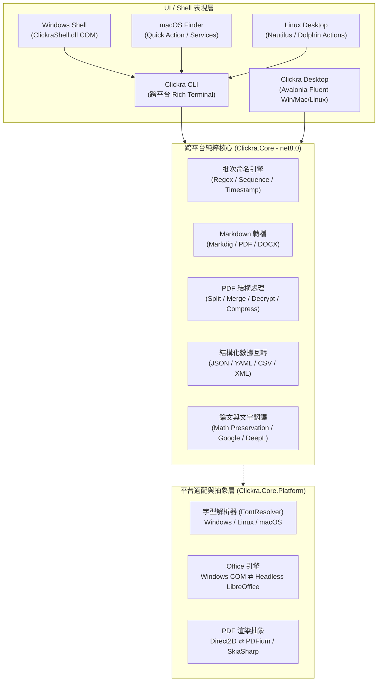

# Clickra 跨平台新世代（Cross-Platform Era）完整工程計畫書

> **目標版本演進**：`v3.19.0` (Core 解耦) $\to$ `v3.20.0` (跨平台 Universal CLI) $\to$ `v4.0.0` (Avalonia 跨平台桌面介面)  
> **發行架構**：.NET 8+ / NativeAOT 零依賴單檔發布（Windows x64 / Linux x64 & ARM64 / macOS x64 & Apple Silicon）  
> **發布日期**：2026 年 11 月

---

## 1. 架構願景與核心思維 (Architecture Vision)

Clickra 目前在 Windows 上已建立完整的轉檔引擎（Word、Excel、PPT、Markdown、PDF 縮減/分割/合併/翻譯/轉圖/解密、批次命名）。然而，現行 `Clickra.Core` 深度綁定 `net8.0-windows10.0.19041.0`、Windows GDI+ 與 COM API。

跨平台計畫的核心目標是：**「將業務與運算邏輯徹底純化，桌面 UI 與系統選單依平台特性無縫適配，發布出零外部環境依賴的超高速單檔工具」**。

---

## 2. 三大階段實施藍圖與版本節奏

---

## 3. 分支規劃與原子提交矩陣 (Branch & Atomic Commit Strategy)

依據 Clickra 分支治理規範：
- 分支前綴必須為 `refactor/` 或 `feat/`。
- 分支後綴嚴格限制為 **2 至 3 個英文單字**，總長度 **$\le 25$ 字元**。
- 嚴格遵守領域隔離（Core / CLI / UI / CI）與原子提交規範（Commit 標題 $\le 72$ 字元，Body 必須為英文編號清單）。

### 階段一：Core 引擎跨平台解耦 (`v3.19.0`)

> **目標**：將 `src/Clickra.Core` 升級為純 `net8.0`（兼顧 Windows 回退），將 Windows 專屬 API 抽至適配介面，確保既有 Windows 測試 100% 通過。

#### 分支 1：`refactor/core-decouple` (13 字元)
* **脈絡與目的**：解耦 `Clickra.Core.csproj`，抽離 Windows-only 參照。
* **預期原子提交**：
  1. `refactor(core): decouple core csproj to multi-target net8.0`
     - 目的：啟用 `<TargetFrameworks>net8.0;net8.0-windows10.0.19041.0</TargetFrameworks>`，建立跨平台編譯基準。
  2. `refactor(core): abstract platform font resolution provider`
     - 目的：將原本直接讀取 `C:\Windows\Fonts` 的邏輯抽象為 `IFontProvider`，實作 Windows、Linux (`/usr/share/fonts`) 與 macOS (`/Library/Fonts`) 搜尋路徑。
  3. `refactor(core): isolate gdi dependencies in rendering pipeline`
     - 目的：將 PDF 翻譯與圖片管線中的 `System.Drawing.Common` 封裝於 Windows 適配區塊，提供跨平台抽象介面。
  4. `test(core): add cross-platform path and font discovery tests`
     - 目的：驗證非 Windows 虛擬路徑與字型比對不會拋出平台無效例外。

#### 分支 2：`refactor/office-engine` (13 字元)
* **脈絡與目的**：將 Office 轉檔能力由 Windows COM 優先改為支援跨平台無頭 LibreOffice。
* **預期原子提交**：
  1. `refactor(core): abstract office conversion execution strategy`
     - 目的：提煉 `IOfficeConvertStrategy`，明確劃分 `ComOfficeStrategy` 與 `LibreOfficeCliStrategy`。
  2. `feat(core): support unix soffice detection and headless invocation`
     - 目的：在 Linux (`/usr/bin/soffice`) 與 macOS (`/Applications/LibreOffice.app`) 偵測並無頭調用轉檔。
  3. `test(core): add office conversion strategy fallback test suite`
     - 目的：驗證無 COM 環境下自動流暢回退至 LibreOffice。

#### 分支 3：`chore/bump-v3-19` (10 字元)
* **脈絡與目的**：版本推進與文件更新。
* **預期原子提交**：
  1. `docs(core): document cross-platform architecture abstractions`
  2. `chore(deps): bump version to 3.19.0.0 for core decoupling`

---

### 階段二：跨平台 Universal CLI (`v3.20.0`)

> **目標**：讓 `Clickra.CLI` 可以在 Linux、macOS 與 Windows 獨立編譯為 NativeAOT 終端單檔，並在 GitHub Actions 建立三平台編譯產線，同時提供 **GitHub Releases（NativeAOT 獨立二進位壓縮包）** 與 **GitHub Packages（.NET Global Tool NuGet 套件）** 雙軌發布。
> **PR 結構**：精簡收斂為 **2 個 PR**（不設置獨立且冗餘的 bump 分支，版本升級與文件同步依規範在功能 PR 內以原子提交完成）。

#### 分支 4：`feat/cli-headless` (12 字元) —— **[已完成合併 ✅ / PR #240]**
* **脈絡與目的**：CLI 終端機無頭模式重構、跨平台終端進度顯示與診斷旗標。
* **交付內容**：
  1. `refactor(cli): decouple headless execution from win32 progress window`
     - 目的：當指令在終端機執行或在非 Windows 系統運作時，完全不初始化 Win32 視窗訊息循環。
  2. `feat(cli): implement rich terminal progress bars for unix console`
     - 目的：在 Linux / macOS / Windows Terminal 提供 ANSI 即時百分比進度條與狹窄終端動態長度調適。
  3. `feat(cli): add platform detection banner and diagnostic output`
     - 目的：輸出 OS、架構、.NET 執行環境與 Office/LibreOffice 轉檔引擎偵測資訊（`--info`, `--diagnostics`）。
  4. `test(cli): add headless execution and platform diagnostics tests`
  5. `chore(msix): bump version to 3.19.10.0`
  6. `docs: update changelog, roadmap, and store listings for v3.19.10.0`

#### 分支 5：`feat/universal-package` (17 字元) —— **[已完成合併 ✅ / PR #241]**
* **脈絡與目的**：多平台編譯適配、GitHub Actions 三平台 NativeAOT 矩陣產線、GitHub Releases 獨立發布包、GitHub Packages (.NET Global Tool) 套件發布，以及升級至 `v3.20.0.0`。
* **交付內容**：
  1. `refactor(core): multi-target core and guard wic winrt dependencies`
  2. `feat(cli): configure net8.0 tool packaging and cross-platform build`
  3. `chore(ci): add cross-platform nativeaot builds and tool packaging`
  4. `test(core): add universal package and tool metadata guards`
  5. `chore(msix): bump version to 3.20.0.0 and update docs`
  6. `chore(ci): exclude core and tests from icongen build target`
  7. `refactor(core): enable windows targeting for cross-platform restore`
  8. `test(core): guard windows targeting property in core project`
  9. `chore(ci): generate icon assets in test job and guard core targets`
  10. `refactor(core): discard unused fallback parameters in platform stubs`
  11. `test(core): extract project name constant in universal package guard`

##### Core／CLI 平台目標與 Windows 原生渲染演進 (Core & CLI Target Delivery)
- **6399398c 回歸與影響版本**：在 `6399398c` 中，為了支援 .NET 全域工具打包（`dotnet pack`）並消除 MSIX 原生發佈時的多目標評估歧義（NETSDK1129），CLI 被改為單一 `net8.0` 目標。然而，`Clickra.Core` 中的 WinRT 與 WIC 僅在 `WINDOWS` 前置編譯符號下生效，導致 Windows 原生發佈版本缺少 `WINDOWS` 定義，PDF 轉圖片、列印與分割預覽退化為僅繪製文字層（照片、色塊、表格框線消失），此回歸影響 `v3.20.0.0` 與 `v3.20.1.0`。
- **現行做法 (v3.20.2.0)**：於 `Clickra.CLI` 與 `Clickra.Desktop` 專案檔中採用條件式覆寫：當 `-r win-*` 時將 `TargetFramework` 改為 `net8.0-windows10.0.19041.0`，完整恢復 Windows 內建 `Windows.Data.Pdf` 向量渲染與 WIC 圖片解碼；通用發佈（Linux、macOS、.NET 全域工具及未帶 `-r` 的本機建置）維持純 `net8.0`。CI 亦在 Windows 矩陣中增補帶有 `-r win-x64` 的 `Clickra.Desktop` 建置 step，確保 Windows 目標於 CI 常態編譯。
- **未來收斂目標**：後續改用跨平台 PDF 引擎（PDFium）與跨平台圖片處理後回到單一 `net8.0` 並移除條件式覆寫。

---

### 階段三：Avalonia 跨平台桌面介面 (`v4.0.0`)

> **目標**：引進 Avalonia UI 11+，將 Fluent Dashboard、Settings、History 與進度視窗轉為跨平台 XAML 實現，以 NativeAOT 發布 Windows/Mac/Linux 桌面套件。
> **PR 結構**：精簡收斂為 **2 個聚焦 PR**（不設置獨立且違規的 release 分支，版本升級與文件同步依規範在功能 PR 內以原子提交完成）。
> **介面版面**：所有畫面依 [v4_desktop_ui_layout.md](v4_desktop_ui_layout.md)（含第 10 節決策紀錄）實作；本節與該規格衝突時以該規格為準。

#### 分支 6：`feat/avalonia-shell` (14 字元) —— **[進行中 🚀]**
* **脈絡與目的**：建立 `src/Clickra.Desktop` 專案結構並實作 Avalonia 11 Fluent 現代主視窗、頂部三分頁導航、深淺色主題（預設淺色）與 NativeAOT 獨立打包支援。**本 PR 只做介面外框，不串接 Core 的轉檔、歷史與設定功能**（分頁文字讀取 Core 語系檔除外）。
* **預期原子提交**：
  1. `feat(shell): initialize avalonia 11 desktop project with fluent theme` —— **[已完成 ✅]**
     - 目的：建立引用 `Clickra.Core` 的 Avalonia 11 桌面專案並配置 Fluent 主題（視窗底層：Windows 11 用 Mica、macOS 用半透明模糊，不支援時退回實心底色，內容區塊維持實心；見介面規格第 7 節）。
  2. `feat(shell): implement top tab navigation shell and workspace frame`
     - 目的：依介面規格建立頂部三分頁導航（轉檔、歷史、設定）、深淺色色票與共用元件（區塊、按鈕、分段按鈕、分段滑桿、動作卡片），以及三個頁面的外框；預設淺色，可在設定頁切換。
  3. `chore(shell): configure nativeaot trimmer and standalone publish script`
     - 目的：配置 Avalonia 核心與 SkiaSharp NativeAOT 剪裁保護與獨立打包腳本，產出免安裝執行檔供本地點擊驗收。
  4. `test(core): add desktop project contracts and architecture guards` —— **[已完成 ✅]**
     - 目的：架構守衛確保桌面專案依賴單向性與各項契約測試 100% 通過。

#### 分支 7：`feat/avalonia-views` (14 字元)
* **脈絡與目的**：依介面規格實作轉檔頁（放檔、動作目錄與動作頁）、歷史紀錄與進度狀態，**串接 Core**。
* **版本調整（2026-11-19 決策）**：本分支升級為 **`v3.21.0.0`**，不是 `v4.0.0.0`。合併後新介面仍是預覽：啟動器優先順序不變、正式發佈與商店套件不含 `Clickra.Desktop`，開發者以 `--desktop` 或 `CLICKRA_DESKTOP=1` 開啟。原列於本分支的「切換 MSIX 主程式」「全平台桌面發布產線」「升級 4.0.0.0」移到下方〈4.0 上線前清單〉。理由：版本號反映使用者實際拿到的東西，合併後正式版使用者打開的仍是 Fluent 或 Win32 介面，標成 4.0 會讓人以為介面換了；且新介面尚未多語系化（見清單 1），不能成為預設。
* **預期原子提交**：
  1. `feat(shell): port convert workspace and action pages to avalonia xaml`
     - 目的：實現檔案拖放、檔案窄列、只列出可用動作的動作目錄，以及每個動作一個動作頁（含滑入／滑回動畫與選項卡片），串接 `ConvertWorkspaceController`。
  2. `feat(shell): port history feed and parked tasks panel to avalonia`
     - 目的：直接重用 `Clickra.Core` 的 `HistoryFeedService` 與 `ParkedTaskController`。
  3. `feat(shell): implement in-window progress and result states`
     - 目的：處理中與完成狀態在同一個視窗內接續顯示（右鍵執行時用精簡小視窗），提供整體進度、取消、當場補救（如密碼）與白話失敗原因，完全對接 `ConversionExecutionService`。
  - 另含 `refactor(core): ...` 原子提交：依介面規格 4.10 調整語系字串（改前改後須先經使用者確認）。
  - **本 PR（分支 6）留下、需在分支 7 接上 Core 的介面項目**（介面已完成，只差功能）：
    - 轉檔頁：有歷史紀錄時，下方區塊由「也可以在檔案總管直接使用」改為「最近處理」清單；「選擇檔案」與拖放。
    - 設定頁：所有設定值讀寫 `SettingsController`（目前只有「外觀」會生效）；記住視窗大小與位置；「檢視日誌」「寄送問題回報」接上現有日誌資料夾與診斷郵件功能（`Localization.BuildDiagnosticsEmail`）；右鍵選單的總開關與勾選清單（介面與摘要文字已完成，只差寫入設定並實際註冊／取消右鍵選單）。
    - 歷史頁：接上歷史清單與篩選。
    - 平台相關文字：「檔案總管」在 macOS 為 Finder、Linux 為檔案管理員。
    - 系統「減少動態效果」設定的偵測（Avalonia 11 尚無 API），開啟時取消介面動畫。
  4. ~~`ci: add cross-platform desktop nativeaot release matrix`~~ → 移到〈4.0 上線前清單〉6。（本分支只在 CI 建置 Windows 目標，見 3.20.2 hotfix。）
  5. ~~`chore(msix): switch msix app entry to desktop and bump to 4.0.0.0`~~ → 改為 `chore(msix): bump version to 3.21.0.0 and update docs`；切換主程式移到清單 6。
  6. ~~`test(shell): add comprehensive view and viewmodel test suite`~~ → 移到清單 9。

#### 4.0 上線前清單 (Release Readiness)

新介面成為使用者預設介面的那一版才是 `v4.0.0.0`。以下全部完成並經 Windows 實機驗收後，才切換啟動器與發佈流程。每項各自一個 PR（分支名稱另定），完成後在此打勾並註明 PR 與版本。

1. [ ] **多語系**：`Clickra.Desktop` 的介面文字目前幾乎都直接寫成繁體中文（2026-11-19 檢查，只有少數地方讀取 `Localization`）。全部改走 Core 語系檔，補齊繁中、簡中、英、日、韓五種語言（介面用語依 [v4_desktop_ui_layout.md](v4_desktop_ui_layout.md) 4.10，改前改後須經使用者確認）；檢查英文等較長文字在 760 寬度下不截斷、不換出版面。計畫見 [v4_localization_plan.md](v4_localization_plan.md)。
2. [ ] **Windows 實機驗收 `feat/avalonia-views`**：轉檔各動作、分割縮圖與放大預覽、列印、PDF → 圖片、有密碼的 PDF（`tmp/enc/` 測試檔）、自訂 AI 服務、拖曳資料夾、設為預設值、歷史、設定、760 × 600 最小視窗、深淺色主題、高 DPI。
3. [ ] **有密碼的 PDF 當場解鎖**：[pdf_password_unlock_plan.md](pdf_password_unlock_plan.md)。完成後拿掉目錄「要先解密」的過渡停用。
4. [ ] **右鍵執行的精簡視窗**：依介面規格 4.x 與畫布「右鍵執行」一列（處理中、全部成功、需要密碼、有檔案沒成功、沒有 Office 轉檔工具），由 4.0 介面取代 3.x 進度視窗；安靜模式行為不變。
5. [ ] **設定沿用**：3.x 的設定、歷史、待繼續任務、右鍵選單勾選在 4.0 原樣可用；第一次開啟 4.0 不重設任何使用者設定。
6. [ ] **發佈流程**：
   - [ ] 啟動器（`ClickraLauncher`）改為優先開 `Clickra.Desktop`，Fluent／Win32 退為備援，最後一版再移除。
   - [ ] `release.yml` 發佈 `Clickra.Desktop`（Windows `-r win-x64`，使用 Windows PDF 引擎）並打包進 MSIX；`build_store.ps1` 同步。
   - [ ] macOS／Linux 桌面套件（App Bundle／AppImage）與 CI 矩陣；若延後，4.0 先只發 Windows 並在此註明。
7. [ ] **體積**：`Clickra.Desktop.exe` 目前約 64 MB（2026-11-18，`-r win-x64` NativeAOT），超過第 5 節 35～40 MB 的目標。依第 6 節裁剪後重新量測，或修訂目標並記錄理由。
8. [ ] **舊介面退場**：決定 Fluent（WinUI 3）可選套件與 Win32 Dashboard 的退場時間；商店上的 Fluent 可選套件如何處理；在 4.0 CHANGELOG 與商店說明公告。
   - **要移除的範圍**（2026-11-20 盤點）：
     - 專案與程式：`src/Clickra.Fluent`、`Clickra.CLI/Dashboard`；`Clickra.CLI/Progress`（右鍵進度視窗）等清單 4 的精簡視窗取代後才移除；`ClickraLauncher` 的 Fluent 啟動路徑。CLI 本身（右鍵執行、無介面模式、.NET 全域工具）保留。
     - 封裝與發佈：`packaging/msix/AppxManifest.Fluent.xml`、`build_store.ps1` 的可選套件、`release.yml` 與 `ci.yml` 中只為 Fluent／Dashboard 存在的步驟。
     - 語系鍵：550 個鍵中約 334 個只被舊介面引用（Fluent 95、Dashboard 52、兩者共用 43、右鍵進度視窗 108、Fluent 與進度視窗共用 36），另有 21 個沒有直接字面引用（多為由命令登錄表動態查詢的 `cmd_*`）。
     - 設定鍵、測試、文件中只屬於舊介面的部分。
   - **怎麼確保沒有漏**：先刪專案，再讓編譯與架構測試找出殘留，不靠人工清單：
     1. 語系鍵必須被用到：五個語系檔中的每個鍵，都要在 `src/` 有字面引用，或由命令登錄表等已知來源動態取得（白名單只列來源，不列個別鍵）。舊介面刪掉後，只屬於它的鍵立刻變成未使用，測試失敗直到移除。
     2. 禁用名稱：`src/`、`scripts/`、`packaging/`、`.github/workflows/` 不得再出現 `Clickra.Fluent`、`Clickra_Fluent.msix`、`AppxManifest.Fluent`、`DashboardWindow`、`ProgressWindow` 等名稱（比照現有禁止 `Clickra.App` 回流的守衛）；`CHANGELOG.md` 與 `docs/history/` 例外。
     3. 設定鍵必須被讀取：`ClickraSettings` 登錄的每個鍵，都要有程式讀取，避免留下只有舊介面用的設定。
     4. 建置與封裝腳本只引用存在的專案與檔案（建置失敗即可發現），並以 `-warnaserror` 建置確保沒有未使用的程式碼警告被忽略。
     5. 文件：以同一組禁用名稱搜尋 `docs/`（歷史文件例外），README、ROADMAP、商店說明不再提到舊介面。
   - 多語系（清單 1）只新增 `ui_*` 鍵並共用 `cmd_*` 等功能名稱鍵，不引用舊介面專用的鍵，讓這一步的刪除不會影響新介面。
9. [ ] **測試**：ViewModel 測試（轉檔流程、分割、合併順序、重新命名預覽、設為預設值、密碼列）與架構測試（桌面端不得直接引用 `Processing` 命名空間等）。
10. [ ] **商店素材**：五種語言的商店說明改寫為 4.0 介面；截圖重拍（深淺色各一套）。
11. [ ] **文件**：README、ROADMAP、`v4_desktop_ui_layout.md` 狀態改為已實作；本計畫書階段三標為完成。
12. [ ] **共用頁面預覽元件**：分割、合併、列印（以及之後的拼貼）使用同一套頁面縮圖（高度固定、寬度依頁面形狀）與放大預覽（蓋滿內容區、整頁／符合寬度、縮放、換頁），從分割的實作抽出成共用元件，各動作只決定工具列上的按鈕。
13. [ ] **列印預覽與選項**：3.x 右鍵列印視窗已有預覽（`PdfPrintPreviewQuery`），4.0 列印卡片目前沒有，屬於退步，必做。版面已定案（2026-11-19，畫布 A3，見 [v4_desktop_ui_layout.md](v4_desktop_ui_layout.md)「列印預覽」）：左欄選項、右邊即時預覽。需同時補 Core：每張紙印幾頁、排列順序、頁框、實際大小／自訂 %、黑白、多份時分份（每張多頁的排法與拼貼共用）。
14. [ ] **合併的縮圖與預覽**：合併順序清單每列加第一頁縮圖，點兩下開放大預覽並可翻頁，讓檔名相似的檔案分得出來；圖片合併、拼接長圖同樣套用。頁面層級的順序調整仍屬之後的「整理頁面」功能。

完成 1～14 後的 `v4.0.0.0` PR 只做：切換啟動器與發佈流程（6 的前兩項若尚未合併）、升版號、CHANGELOG、商店文件。

#### 從 3.21 到 4.0 的順序 (Sequence to 4.0)

上面的清單依「做什麼」編號；實際依下表的順序做。排序原則：越晚做越貴的先做（多語系）、影響現有 3.x 使用者的修正先做（Office COM、密碼）、有相依的照相依排、退場放最後。每一步各自一個 PR、各自升一個次版號；版號為預估，以實際合併順序為準。

| 步驟 | 版本（預估） | 內容 | 清單項目／計畫 | 相依 |
| :--- | :--- | :--- | :--- | :--- |
| 0 | 3.22（與第 1 步同一個分支、同一版） | 修正：壓縮 PDF 不再移除內嵌字型，Fluent、經典儀表板、新介面都拿掉「精簡內容串流」與「移除內嵌字型」開關；處理途中找不到的輸入檔記為失敗，不再算成功。只改新介面（舊介面 4.0 退場，不另改）：繼續暫停的工作前先檢查檔案、拿掉「暫停的工作保留」設定改顯示「暫停了 N 天」、建議信不附數量。Core 依保留天數自動刪除暫停工作的邏輯，等第 12 步舊介面退場時一起拿掉 | 見 [v4_desktop_ui_layout.md](v4_desktop_ui_layout.md) 決策紀錄 2026-11-20 | — |
| 1 | 3.22 | 桌面端多語系：字串移入語系檔、五種語言、依語言選字型、日期格式、禁止寫死文字的測試 | 1；[v4_localization_plan.md](v4_localization_plan.md) | — |
| 2 | 3.22.x | Core 進度與錯誤訊息多語系（3.x 也受益） | 1；同上 3.6 | 1 |
| 3 | 3.23 | Office 轉檔改走 COM，不再用會被防毒軟體攔下的 PowerShell 指令（影響現有使用者，優先） | [office_com_direct_plan.md](office_com_direct_plan.md) | — |
| 4 | 3.24 | 有密碼的 PDF 當場解鎖、真正的「略過這個檔案」、右鍵執行遇到密碼改為略過；拿掉目錄的過渡停用 | 3；[pdf_password_unlock_plan.md](pdf_password_unlock_plan.md) | 1（新字串直接進語系檔） |
| 5 | 3.25 | 共用頁面預覽元件（從分割抽出）→ 列印預覽與新列印選項（含 Core 每張多頁等）→ 合併、圖片合併、拼接長圖的縮圖與預覽 | 12、13、14 | 1 |
| 6 | 3.26 | 右鍵精簡視窗：由新介面取代 3.x 右鍵進度視窗（處理中、成功、需要密碼、失敗、沒有 Office 工具）；安靜模式不變 | 4 | 4（需要密碼的流程）、1 |
| 7 | 3.26 | 功能圖示辨識度（16 px 與深色背景） | [feature_icon_recognition_plan.md](feature_icon_recognition_plan.md) | — |
| 8 | 3.27 | 設定沿用（3.x 的設定、歷史、待繼續任務、右鍵勾選在新介面原樣可用）與 ViewModel 測試補齊 | 5、9 | 1～6 |
| 9 | 3.27 | 體積裁剪（目標見第 5、6 節）；發佈流程先把 `Clickra.Desktop` 打包進正式套件但**不設為預設**，讓 `--desktop` 在正式版也能試用 | 7、6 的第二項 | 8 |
| 10 | — | Windows 全面實機驗收（五種語言、深淺色、高 DPI、最小視窗）、商店截圖與說明、文件 | 2、10、11 | 1～9 |
| 11 | **4.0.0.0** | 啟動器改為優先開新介面；CHANGELOG 與商店公告舊介面退場時程 | 6 的第一項、8 的公告 | 10 |
| 12 | 4.0.x／4.1 | 移除 Fluent、Dashboard、右鍵進度視窗與只屬於它們的語系鍵、設定、封裝、CI 步驟（依 8 的四道檢查） | 8 | 11 後觀察一段時間無回報問題 |
| 13 | 4.0 之後 | macOS／Linux 桌面套件 | 6 的第三項 | 12 |

4.0 之後再排（不在上線前清單內）：拼貼（[collage_layout_plan.md](collage_layout_plan.md)）、整理頁面（排序、刪頁、旋轉，另寫計畫）、改用 PDFium 與跨平台圖片處理以回到單一 `net8.0`（見前文〈Core／CLI 平台目標〉）、PDF 極限壓縮後續階段（[pdf_compression_future_roadmap.md](pdf_compression_future_roadmap.md)）。

---

## 4. 發布通路矩陣 (Distribution Matrix)

| 平台 | 散布型態 | 發布機制 / 套件管理 | 使用者安裝指令 |
| :--- | :--- | :--- | :--- |
| **All Platforms** | .NET Global Tool | **GitHub Packages (NuGet)** | `dotnet tool install -g Clickra --add-source https://nuget.pkg.github.com/Youchenjiang/index.json` |
| **Windows** | 完整桌面應用 | **Microsoft Store / WinGet** | `winget install Clickra` |
| **Windows** | 免安裝 CLI | **GitHub Releases ZIP / Scoop** | `scoop install clickra` |
| **macOS** | CLI + App Bundle | **Homebrew Tap / Releases DMG** | `brew install youchenjiang/tap/clickra` |
| **Linux** | CLI + AppImage | **GitHub Tarball / Flathub / AUR** | `sudo tar -xzf clickra-*.tar.gz -C /usr/local/bin` |

---

## 5. 風險評估與回滾預案 (Risk & Contingency)

1. **Windows 既有功能回歸風險**：
   - **防護措施**：階段一的所有解耦改動必須通過本機 `tests/Clickra.Core.Tests`（506 項測試 + 87 項架構守衛）與真實 PDF 轉檔回歸。
   - **回滾機制**：若多目標架構影響 Windows 原生 NativeAOT 體積，Windows 產線優先維持專屬編譯路徑。
2. **Avalonia NativeAOT 二進位體積控制**：
   - **目標**：單檔桌面應用在未內嵌大字型時限制在 35 MB 以內；內嵌 Noto Sans TC 子集後整體控制在 40 MB 以內；最終 MSIX 下載體積控制在 25～28 MB 區間（詳見第 6 節詳細盤點）。
   - **措施**：開啟 `<PublishTrimmed>true</PublishTrimmed>` 與 `<OptimizationPreference>Size</OptimizationPreference>`，並精確配置 `<TrimmerRootAssembly>`。
3. **字型跨平台渲染保真度**：
   - **措施**：Markdown 與 PDF 處理模組內建開源字型（KaiU / Noto Sans CJK）搜尋與備援回退機制，確保在沒有微軟字型的 Linux 機器上中文不缺字、不亂碼。

---

## 6. 二進位體積與套件依賴裁剪盤點 (Binary Footprint & Dependency Trimming)

本節記錄 2026-11-15 針對 Clickra 從現行 3.x Win32 AOT 架構遷移至 4.0 Avalonia 桌面端時的實測二進位體積、MSIX 壓縮數據，以及向兄弟專案 **TapStrum** 借鏡的依賴裁剪架構實踐。

### 6.1 現行 3.x Win32 AOT MSIX 實測基準

現行 3.x Windows MSIX 採用 Win32 GDI+ 儀表板與 NativeAOT CLI，實測各元件與封裝數據如下：

| 元件名稱 | 未壓縮大小 (磁碟佔用) | 說明 |
| :--- | :--- | :--- |
| `Clickra.exe` | 25.53 MB | Win32 GDI+ 儀表板 + CLI 轉檔核心 |
| `ClickraShell.dll` | 6.40 MB | 檔案總管原生右鍵選單延伸模組 |
| `ClickraLauncher.exe` | 1.82 MB | NativeAOT 啟動路由與參數解析器 |
| `libwebp*.dll` 等執行檔 | 0.45 MB | WebP / 圖片處理 Native 動態程式庫 |
| 圖示、PRI 語系、資訊清單 | 0.15 MB | 22 個選單圖示、5 國語系資源、清單 |
| **安裝後總磁碟空間** | **約 34.35 MB** | 解壓縮部署於 WindowsApps 之實際空間 |
| **最終下載體積 (`Clickra.msix`)** | **15.51 MB** | **Deflate 壓縮實測值** |

### 6.2 4.0 Avalonia 桌面端二進位組成盤點

4.0 遷移至跨平台 Avalonia 11 NativeAOT 後，各獨立元件之二進位盤點如下：

| 檔案名稱 | 未壓縮大小 | 說明 |
| :--- | :--- | :--- |
| `Clickra.Desktop.exe` | 39.24 MB | Avalonia Fluent 主程式（含 4.4 MB Noto Sans TC 內嵌字型子集） |
| `libSkiaSharp.dll` | 8.98 MB | 2D 向量繪圖引擎核心 |
| `av_libglesv2.dll` | 4.23 MB | ANGLE OpenGL ES 轉 DirectX 轉譯層 |
| `libHarfBuzzSharp.dll` | 1.53 MB | OpenType 高級文字塑形引擎 |
| `ClickraShell.dll` | 6.40 MB | 檔案總管右鍵選單延伸模組（延續 Windows 專屬） |
| `ClickraLauncher.exe` | 1.82 MB | 跨平台啟動路由 |
| WebP 與其他資產 | 0.60 MB | 圖片 Native 組件、圖示與語系 |

* 實測將 `publish/desktop` 執行階段全部檔案進行 MSIX 標準 Deflate 壓縮測試：**壓縮後體積為 23.6 MB**。

### 6.3 依賴裁剪策略（對照 TapStrum 專案實踐）

兄弟專案 **TapStrum** 在 WinUI 3（Windows App SDK）架構下，透過以下手法自帶動態瘦身：
1. **黑名單暴力剔除**：在 `build_msix.ps1` 排除 `DirectML.dll`（~35MB）、`onnxruntime.dll`（~20MB）、`NPUDetect.dll` 等無關 AI 庫，單刀砍除 ~70 MB。
2. **依賴模式切換**：改用 `-p:WindowsAppSDKSelfContained=false`，將 Windows App Runtime 改為系統框架依賴。

**Clickra 4.0 的裁剪機制與進一步手動瘦身方向**：

* **現行已落實之 NativeAOT 編譯期修剪**：
  - `<PublishAot>true</PublishAot>` 全程式靜態分析修剪，剔除未引用之 .NET 類別庫。
  - `<OptimizationPreference>Size</OptimizationPreference>` 優先壓制機器碼體積。
  - `<StripSymbols>true</StripSymbols>` 發行時自動剝離 153 MB PDB 除錯符號。
* **下一階段主動依賴瘦身計畫**：
  1. **移除 Inter 字型依賴（預估省 ~1.2 MB）**：目前已內嵌 Noto Sans TC 與 Windows 系統 Segoe UI，可解除 `Avalonia.Fonts.Inter` 依賴。
  2. **Noto Sans TC 字型子集蒸餾（預估省 ~2～3 MB）**：目前 4.4 MB 字型包含完整繁中字表，後續透過 pyftsubset 萃取介面專用常用字表，目標壓至 1.0～1.5 MB。
  3. **評估 ANGLE 轉譯層 (`av_libglesv2.dll` 4.23 MB)**：Windows 11 上評估直通 D3D11 / Software 渲染的可行性，若不依賴 ANGLE 可在打包時過濾。
  4. **單一二進位整合（最重要的 MSIX 瘦身，預估省 18～25 MB）**：在 4.0 MSIX 打包時，徹底移除 3.x 舊版 25.5 MB 的 `Clickra.exe`，由 `ClickraLauncher` 統一路由無介面模式與 Avalonia 桌面端，避免重複夾帶兩套執行期。

### 6.4 MSIX 封裝體積演進與目標

| 版本 / 方案 | 磁碟安裝空間 | MSIX 下載體積 | 備註 |
| :--- | :--- | :--- | :--- |
| **3.x 現行版** | 34.35 MB | **15.51 MB** | Win32 GDI+ Dashboard |
| **4.0 雙軌並存過渡期** | 約 80.8 MB | **約 34～36 MB** | 若同時保留舊版 CLI + 新版 Desktop |
| **4.0 統一整合版 (情境 A)** | 約 62.8 MB | **約 27～28 MB** | 移除舊版 Dashboard，Launcher 統一路由 |
| **4.0 極限裁剪版 (目標)** | 約 52.0 MB | **約 22～25 MB** | 蒸餾字型、移除 Inter、單一入口 |
