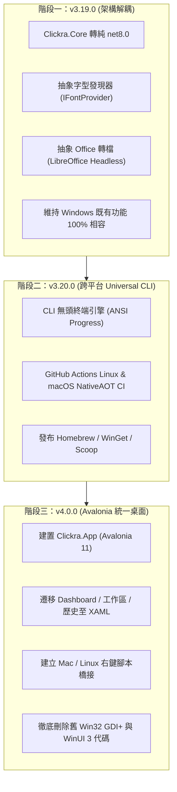

# Clickra 4.0 跨平台統一架構規格書 (Cross-Platform Unification RFC & Specification)

| 欄位 | 內容 |
| :--- | :--- |
| **文件狀態** | 已核准規劃 (Approved Proposal) |
| **目標版本** | `v3.19.0` (Core 解耦) $\to$ `v3.20.0` (Universal CLI) $\to$ `v4.0.0` (Avalonia 統一介面) |
| **起草日期** | 2026 年 11 月 |
| **生效週期** | 長期架構指導文件 (Long-term Architectural North Star) |

---

## 1. 背景與動機 (Background & Motivation)

### 1.1 現行架構之雙軌困境 (Dual-Track Dilemma)
Clickra 在 3.x 時代為了兼顧「現代 Windows 11 視覺」與「零依賴輕量安裝」，演化出了複雜的雙軌架構（Dual-Track）：
1. **舊 Win32 GDI+ 介面** (`src/Clickra.CLI/Dashboard/`, `Progress/`)：
   - 優點：純 NativeAOT 編譯、體積小（< 20MB）、零 Windows App Runtime 依賴、冷啟動小於 20ms。
   - 缺點：依賴 GDI+ 手繪畫布、Win32 訊息循環極其繁雜、圈複雜度高、維護極為痛苦。
2. **WinUI 3 介面** (`src/Clickra.Fluent`)：
   - 優點：採用微軟現代 XAML 與 Fluent Design System，外觀質感極佳。
   - 缺點：深度依賴 Windows App Runtime，微軟官方架構對 NativeAOT 支援殘缺，無法作為獨立免安裝工具發布。

### 1.2 技術債痛點：前端雙倍維護地獄
目前任何新功能（如批次命名、Markdown 轉檔、PDF 密碼），開發者都必須在 **Win32 GDI+** 刻一次自繪邏輯，又要在 **WinUI 3** 寫一次 XAML/C#。這導致：
- 代碼庫膨脹，維護成本翻倍。
- 測試矩陣複雜度隨功能增加呈幾何級數增長。
- 平台被永久鎖死在 Windows 10/11，無法觸達龐大的 Linux 與 macOS 開發者及辦公族群。

---

## 2. 戰略目標與核心原則 (Strategic Objectives)

本規格書定義 Clickra 邁向 4.0 的核心原則：**「以減法代替加法，終結雙軌維護，統一為單一跨平台架構」**。

1. **單一統一介面 (Single UI Consolidation)**：
   - 4.0 上線時，**全面廢除並刪除**舊 Win32 GDI+ 介面代碼與 WinUI 3 代碼。
   - 全專案只維護**唯一一套現代跨平台 XAML 介面**（基於 Avalonia UI 11+）。
2. **NativeAOT 零依賴堅持**：
   - 全面支援 NativeAOT 預先編譯為原生二進位檔。
   - 使用者在 Windows、macOS、Linux 下載即用，**完全無需預先安裝 .NET Runtime / SDK**。
3. **無頭命令列（Headless CLI）與系統右鍵深度整合**：
   - CLI 成為純終端工具，可作為微服務或腳本調用。
   - 依平台提供原生右鍵整合（Windows COM 快顯選單、macOS Finder Quick Actions、Linux 桌面 Actions）。

---

## 3. 非功能性需求指標 (Non-Functional Requirements, NFRs)

任何進入 4.0 架構的實作，必須滿足以下硬性效能與體積標準：

| 指標項 | 目標門檻 | 驗收方式 |
| :--- | :--- | :--- |
| **冷啟動延遲 (Cold Start)** | $\le 30\text{ ms}$ (CLI) / $\le 80\text{ ms}$ (GUI) | Windows / Linux / macOS 實機基準測試 |
| **單檔二進位體積** | CLI $\le 20\text{ MB}$ / GUI $\le 35\text{ MB}$ | NativeAOT 發布產物計量 |
| **執行時期記憶體** | 閒置時 $\le 40\text{ MB}$，峰值轉檔 $\le 250\text{ MB}$ | OS Process 記憶體監控 |
| **視覺一致性** | 100% 還原 Windows 11 Fluent Design | 包含 Mica / Acrylic、動態圓角、深淺色自適應 |
| **零環境污染** | 免安裝、免管理員權限、零註冊表殘留（CLI） | 乾淨虛擬機驗證 |

---

## 4. 技術選型決策紀錄 (Architecture Decision Record, ADR)

### 決策：選擇 Avalonia UI 11+ 作為統一 GUI 框架

#### 評估候選項：
1. **.NET MAUI**：
   - 評估：微軟官方明確拒絕支援 Linux 桌面；行動端映射架構在桌面端 Bug 頻發、記憶體佔用高；NativeAOT 桌面支援極不成熟。❌ **排除**。
2. **Uno Platform**：
   - 評估：模擬 WinUI 3 API，但在 Linux 與 macOS 上編譯包體肥大，配置與除錯鏈路過長。❌ **排除**。
3. **Electron / Tauri / Web-based**：
   - 評估：需要引入 Node.js/Rust/Web 雙語言技術棧，破壞純 C# 現代單一體系；Chromium 記憶體佔用過高。❌ **排除**。
4. **Avalonia UI 11+**：
   - **採納理由**：
     - **歷史與商業健康度**：自 2014 年起運作逾 12 年，背後有 AvaloniaUI OÜ 企業級商業授權支撐，並獲 JetBrains、西門子、微軟內部團隊廣泛採用。
     - **NativeAOT 一等公民**：內建 Compiled XAML（編譯期原始碼生成器），完全杜絕執行期反射，與 NativeAOT 深度融合。
     - **原生 Fluent Theme**：官方提供標準 Fluent 主題，在 Windows、Mac、Linux 上均具備一線商業軟體水準。
     - **自主渲染引擎**：基於 Google Skia 直接渲染至 DirectX / Metal / Vulkan，作業系統更新完全不影響畫面穩定性。

---

## 5. 三階段演進藍圖 (Phased Migration Roadmap)



---

## 6. 舊架構除役標準 (Sunsetting & Deprecation Criteria)

為了防止技術債在 4.0 中無限期殘留，設定以下**剛性刪除標準**：

> [!CAUTION] 剛性退役規則
> 當 `v4.0.0` 候選版 (RC) 達成以下條件時，舊介面代碼必須在同一 PR 中**物理刪除**，不得以「保留回退」為藉口留存：

1. **`src/Clickra.Fluent` 刪除條件**：
   - Avalonia 桌面版在 Windows 10/11 上完整通過：檔案拖放、轉檔前設定、多語言切換、歷史紀錄檢索。
   - MSIX 與 Microsoft Store 打包流程改為封裝 Avalonia 產物並驗收通過。
   - 達成後：執行 `git rm -r src/Clickra.Fluent`。
2. **`src/Clickra.CLI/Progress/` 與 `Dashboard/` 刪除條件**：
   - 跨平台 CLI 已能在終端機輸出標準文字/ANSI 進度條。
   - 達成後：執行刪除 Win32 自繪視窗相關檔案（`ProgressWindow.*`、`DashboardWindow.*`、`VisualSplitter.cs`、`ModernControls.cs`）。
   - `src/Clickra.CLI` 回歸為純粹的 Console 可執行檔。

---

## 7. 專案目錄結構演進比對

### 3.x 現行目錄（雙軌冗餘）
```text
src/
├── Clickra.CLI/          # 混雜了 CLI、Win32 GDI+ Dashboard 與 ProgressWindow
├── Clickra.Core/         # 綁定 net8.0-windows10.0.19041.0
├── Clickra.Fluent/       # WinUI 3 介面（重複實作了一次 UI）
├── ClickraLauncher/      # 偵測 runtime 的啟動器
└── ClickraShell/         # Windows 11 Explorer COM DLL
```

### 4.0 目標目錄（清晰、單一、純粹）
```text
src/
├── Clickra.App/          # 【唯一 GUI】Avalonia 11 Fluent 桌面端（Win/Mac/Linux）
├── Clickra.CLI/          # 【唯一 CLI】跨平台無頭終端可執行檔（NativeAOT）
├── Clickra.Core/         # 【唯一 Core】純 net8.0 跨平台運算核心
├── ClickraShell/         # Windows Explorer 現代快顯選單 COM 代理
└── ClickraShell.Mac/     # macOS Finder Quick Action / Services 配置與生成器
```

---

## 8. 結論

本文件作為 Clickra 邁向 4.0 世代的根本指南。所有後續分支命名、PR 範疇與功能擴張，皆應對齊本規格書之規劃，確保架構在持續前進的過程中朝向**更高代碼純度、更低維護成本、更廣平台覆蓋**的目標收斂。
